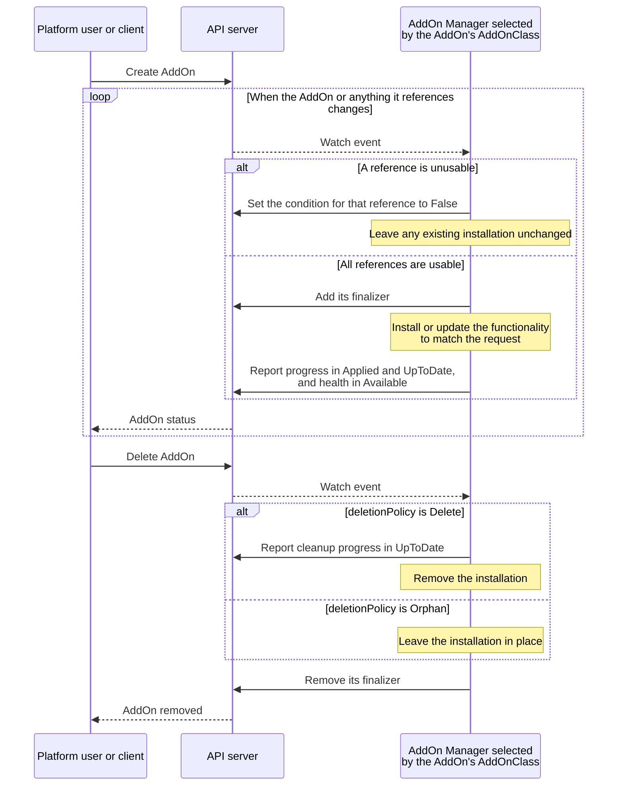
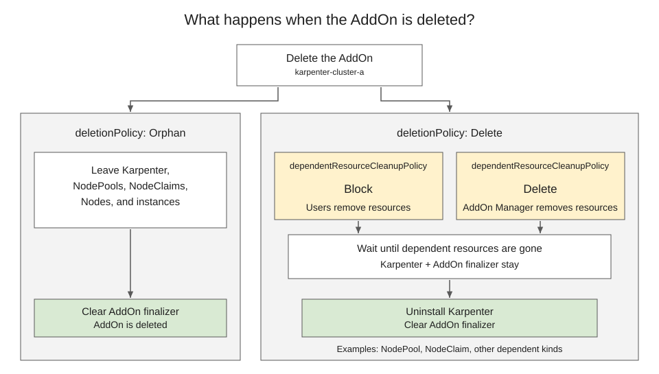

# KEP-6510: ClusterProfile AddOn API

<!-- toc -->
- [Release Signoff Checklist](#release-signoff-checklist)
- [Summary](#summary)
- [Motivation](#motivation)
  - [Terminology](#terminology)
  - [Existing Add-on Systems](#existing-add-on-systems)
  - [Relationship to the Work API](#relationship-to-the-work-api)
  - [Examples of AddOn Functionality](#examples-of-addon-functionality)
  - [Add-on Types](#add-on-types)
  - [Goals](#goals)
  - [Non-Goals](#non-goals)
- [Proposal](#proposal)
  - [User Stories](#user-stories)
    - [Story 1: Self-service add-ons](#story-1-self-service-add-ons)
    - [Story 2: Status and troubleshooting](#story-2-status-and-troubleshooting)
    - [Story 3: Transparent to clients](#story-3-transparent-to-clients)
    - [Story 4: Single cluster](#story-4-single-cluster)
  - [API Overview](#api-overview)
  - [Users and Resources](#users-and-resources)
  - [Risks and Mitigations](#risks-and-mitigations)
- [Design Details](#design-details)
  - [Protocol Overview](#protocol-overview)
  - [API Types](#api-types)
  - [Parameters References](#parameters-references)
  - [AddOn Manager Selection and AddOnClass Lifecycle](#addon-manager-selection-and-addonclass-lifecycle)
  - [Target Changes](#target-changes)
  - [Status Contract](#status-contract)
  - [Reconciliation](#reconciliation)
  - [Deletion](#deletion)
  - [Authorization and Scale](#authorization-and-scale)
  - [AddOn Manager Library](#addon-manager-library)
  - [Functionality Implementation Patterns](#functionality-implementation-patterns)
    - [Reconciliation by the AddOn Manager](#reconciliation-by-the-addon-manager)
    - [Reconciliation by a dedicated controller](#reconciliation-by-a-dedicated-controller)
    - [Integration with an existing controller or service](#integration-with-an-existing-controller-or-service)
  - [Topology Examples](#topology-examples)
    - [Local cluster](#local-cluster)
    - [Local cluster in a ClusterSet](#local-cluster-in-a-clusterset)
    - [One hub and multiple spokes](#one-hub-and-multiple-spokes)
    - [Multiple hubs and one spoke](#multiple-hubs-and-one-spoke)
  - [Manifest Examples](#manifest-examples)
    - [OpenTelemetry Collector for a spoke cluster](#opentelemetry-collector-for-a-spoke-cluster)
    - [OpenTelemetry Collector for the local cluster](#opentelemetry-collector-for-the-local-cluster)
  - [Implementation Examples](#implementation-examples)
    - [Hosted Karpenter and dependent resources](#hosted-karpenter-and-dependent-resources)
  - [Test Plan](#test-plan)
      - [Prerequisite testing updates](#prerequisite-testing-updates)
      - [Unit tests](#unit-tests)
      - [Integration tests](#integration-tests)
      - [e2e tests](#e2e-tests)
  - [Graduation Criteria](#graduation-criteria)
    - [Alpha](#alpha)
    - [Beta](#beta)
    - [GA](#ga)
  - [Upgrade / Downgrade Strategy](#upgrade--downgrade-strategy)
  - [Version Skew Strategy](#version-skew-strategy)
- [Production Readiness Review Questionnaire](#production-readiness-review-questionnaire)
  - [Feature Enablement and Rollback](#feature-enablement-and-rollback)
  - [Rollout, Upgrade and Rollback Planning](#rollout-upgrade-and-rollback-planning)
  - [Monitoring Requirements](#monitoring-requirements)
  - [Dependencies](#dependencies)
  - [Scalability](#scalability)
  - [Troubleshooting](#troubleshooting)
- [Implementation History](#implementation-history)
- [Drawbacks](#drawbacks)
- [Alternatives](#alternatives)
- [References](#references)
<!-- /toc -->

## Release Signoff Checklist

<!--
**ACTION REQUIRED:** In order to merge code into a release, there must be an
issue in [kubernetes/enhancements] referencing this KEP and targeting a release
milestone **before the [Enhancement Freeze](https://git.k8s.io/sig-release/releases)
of the targeted release**.

For enhancements that make changes to code or processes/procedures in core
Kubernetes—i.e., [kubernetes/kubernetes], we require the following Release
Signoff checklist to be completed.

Check these off as they are completed for the Release Team to track. These
checklist items _must_ be updated for the enhancement to be released.
-->

Items marked with (R) are required *prior to targeting to a milestone / release*.

- [ ] (R) Enhancement issue in release milestone, which links to KEP dir in [kubernetes/enhancements] (not the initial KEP PR)
- [ ] (R) KEP approvers have approved the KEP status as `implementable`
- [ ] (R) Design details are appropriately documented
- [ ] (R) Test plan is in place, giving consideration to SIG Architecture and SIG Testing input (including test refactors)
  - [ ] e2e Tests for all Beta API Operations (endpoints)
  - [ ] (R) Ensure GA e2e tests meet requirements for [Conformance Tests](https://github.com/kubernetes/community/blob/master/contributors/devel/sig-architecture/conformance-tests.md)
  - [ ] (R) Minimum Two Week Window for GA e2e tests to prove flake free
- [ ] (R) Graduation criteria is in place
  - [ ] (R) [all GA Endpoints](https://github.com/kubernetes/community/pull/1806) must be hit by [Conformance Tests](https://github.com/kubernetes/community/blob/master/contributors/devel/sig-architecture/conformance-tests.md) within one minor version of promotion to GA
- [ ] (R) Production readiness review completed
- [ ] (R) Production readiness review approved
- [ ] "Implementation History" section is up-to-date for milestone
- [ ] User-facing documentation has been created in [kubernetes/website], for publication to [kubernetes.io]
- [ ] Supporting documentation—e.g., additional design documents, links to mailing list discussions/SIG meetings, relevant PRs/issues, release notes

<!--
**Note:** This checklist is iterative and should be reviewed and updated every time this enhancement is being considered for a milestone.
-->

[kubernetes.io]: https://kubernetes.io/
[kubernetes/enhancements]: https://git.k8s.io/enhancements
[kubernetes/kubernetes]: https://git.k8s.io/kubernetes
[kubernetes/website]: https://git.k8s.io/website

## Summary

Platform administrators need to distinguish an add-on request with invalid
configuration, an update still in progress, and an installation that is current
but unusable. The proposed ClusterProfile AddOn API gives them common
conditions for these observations across AddOn Manager implementations. This
lets a dashboard display the state of metrics collection, certificate
management, or Node provisioning without interpreting each add-on system's
status model.

An `AddOn` records a request for one target cluster, identified by its
[`ClusterProfile`](../4322-cluster-inventory/README.md), and the AddOn Manager's
observations of that request. A platform administrator offers functionality
through an `AddOnClass`, selecting the responsible AddOn Manager. A platform
user selects that AddOnClass.

Each AddOn Manager defines its parameters, installation mechanisms, access
requirements, and health checks, and follows a common protocol for receiving
requests and reporting their status. It can provide hosted or serverless
functionality using components on the target, on another cluster, or in an
external service. The API is mainly for multicluster management. A single
cluster can also use it as a [local cluster](#local-cluster) for its own
add-ons.

## Motivation

Today, a platform administrator may need to read one API for a certificate
management installation and another for a metrics collection installation.
A dashboard must interpret each system's status to answer the same questions:
was the request accepted, is its configuration usable, has it been applied, is
the installation current, and is the functionality available? Adding another
add-on system repeats this integration work.

SIG-Multicluster APIs cover several parts of multicluster management:

- [ClusterProfile](../4322-cluster-inventory/README.md) identifies a cluster and
  provides access information.
- [PlacementDecision](../5313-placement-decision-api/README.md) lists the
  clusters that a scheduler selected.
- The [Work
  API](../6456-work-api/README.md)
  groups Kubernetes resource manifests for delivery to a managed cluster.
- The [About API](../2149-clusterid/README.md) stores cluster metadata, such as
  the cluster ID, in `ClusterProperty` resources.
- The [Multi-Cluster Services API](../1645-multi-cluster-services-api/README.md)
  makes Services exported from one cluster available to other clusters.

None of these APIs defines what functionality a cluster should have, such as
certificate management or metrics collection, or reports whether the cluster
provides it.

### Terminology

- Add-on: [Software, Kubernetes objects, or a service](#add-on-types) that
  [extends the functionality of a Kubernetes
  cluster](https://kubernetes.io/docs/concepts/cluster-administration/addons/),
  such as CRDs, network policies, DNS, Pod networking, certificate management,
  or metrics collection.

- Add-on system: An API or tool that lets users request an add-on for a
  cluster and reports its status.

- Add-on catalog: The list of add-ons that an add-on system offers.

- Platform administrator: A person or team that decides which add-ons a
  platform's clusters can have and how they are provided.

- Platform user: A person or team that uses a platform's clusters and requests
  the add-ons they need from those the platform offers.

- AddOn: A namespaced API resource through which a platform user or client
  requests functionality for one ClusterProfile and observes its status.

- AddOnClass: A namespaced API resource through which a platform
  administrator selects an AddOn Manager and optionally supplies shared
  parameters.

- AddOn Manager: An entity selected by `AddOnClass.spec.manager.name` that
  provides the requested functionality, reports status, and manages the
  installation's lifecycle.

- Parameters object: An API object referenced through `parametersRef`
  to configure an AddOnClass or AddOn. The AddOn Manager defines the supported
  kinds and how shared and per-AddOn parameters combine.

- Managed installation: The resources and services managed for an AddOn
  to provide the requested functionality. These may include target-cluster
  resources, hub-hosted components, and external services.

- Target cluster: The Kubernetes cluster represented by the ClusterProfile
  referenced by an AddOn. The requested functionality is for this cluster;
  components providing it can run elsewhere.

- Hub cluster: A Kubernetes cluster hosting AddOn API resources that request
  functionality for other clusters.

- Spoke cluster: A target cluster for an AddOn hosted on a hub cluster. For
  example, an AddOn on a hub can target a ClusterProfile representing the
  spoke cluster `cluster-a`.

- Local cluster: The Kubernetes cluster hosting the AddOn API resources
  when an AddOn requests functionality for that same cluster.

These roles depend on the request. A cluster can be a spoke for an AddOn on
another cluster and the local cluster for an AddOn in its own API.

### Existing Add-on Systems

Add-on systems are common, but each requests add-ons, lists them, and reports
their status in its own way:

| Add-on system | Request | Catalog | Status |
| --- | --- | --- | --- |
| [Open Cluster Management](https://open-cluster-management.io/docs/developer-guides/addon/) | `ManagedClusterAddOn` | `ClusterManagementAddOn` | `ManagedClusterAddOn` conditions |
| [Amazon Elastic Kubernetes Service add-ons](https://docs.aws.amazon.com/eks/latest/userguide/eks-add-ons.html) | `CreateAddon` API | `DescribeAddonVersions` API | Add-on `status` and `health` |
| [Google Kubernetes Engine add-ons](https://cloud.google.com/kubernetes-engine/docs/reference/rest/v1/projects.locations.clusters#addonsconfig) | Cluster `addonsConfig` field | `AddonsConfig` fields | Cluster status |
| [Cluster API Add-on Provider for Helm](https://github.com/kubernetes-sigs/cluster-api-addon-provider-helm/blob/v0.6.4/docs/quick-start.md) | `HelmChartProxy` | None | `HelmReleaseProxy` status |
| [kubeadm](https://kubernetes.io/docs/reference/setup-tools/kubeadm/kubeadm-init-phase/#cmd-phase-addon) | `kubeadm init phase addon` | `coredns` and `kube-proxy` subcommands | None |
| [minikube](https://minikube.sigs.k8s.io/docs/commands/addons/) | `minikube addons enable` | `minikube addons list` | `minikube addons list` |

Platform teams and multicluster projects can implement AddOn Managers to
expose their offerings through AddOnClasses. Platforms such as
[Open Cluster Management](https://open-cluster-management.io/),
[KubeFleet](https://kubefleet.dev/), and [Clusternet](https://clusternet.io/)
could use this API for an [add-on catalog](#examples-of-addon-functionality).

### Relationship to the Work API

The Work API and higher-level controllers can address targeting,
configuration, status reporting, and cleanup for an add-on. The APIs differ in
what they describe:

| Question | Work API | ClusterProfile AddOn API |
| --- | --- | --- |
| What does the request describe? | Resource manifests to deliver to a managed cluster | Functionality offered by an AddOnClass for one ClusterProfile |
| Who chooses the implementation and configuration? | The caller or a higher-level controller composes the manifests | The platform administrator sets the AddOnClass's AddOn Manager and optional shared parameters. The platform user selects that AddOnClass and optional per-AddOn parameters. |
| What does status describe? | Individual resource conditions and Work-wide conditions summarizing the delivered manifests | Acceptance, reference resolution, and whether the entire managed installation is applied, current, and usable, including any hosted components or external services |
| What does the lifecycle cover? | Updates to the manifests and cleanup of the delivered resources | Changes to the request's AddOnClass, parameters, and current target, and cleanup of the managed installation |

An AddOn Manager can use Work to deliver resources and separately manage a
hosted controller or an external service. The AddOn Manager reports status and
handles cleanup for the entire installation. A platform user can request this
functionality without composing its components or choosing where they run, as
in the [hosted Karpenter example](#hosted-karpenter-and-dependent-resources).

### Examples of AddOn Functionality

An AddOn Manager could offer the following functionality through these
illustrative AddOnClasses.

| Example AddOnClass | Project | Functionality users could request for the target cluster |
| --- | --- | --- |
| `cert-manager` | [cert-manager](https://cert-manager.io/docs/) | Automated TLS certificate issuance and renewal. |
| `cilium` | [Cilium](https://docs.cilium.io/en/stable/overview/component-overview/) | Pod networking and network-policy enforcement. |
| `rook-ceph` | [Rook Ceph](https://www.rook.io/docs/rook/latest/Getting-Started/storage-architecture/) | Ceph-backed block, shared filesystem, and object storage. |
| `knative` | [Knative Serving](https://knative.dev/docs/serving/) and [Eventing](https://knative.dev/docs/eventing/) | Autoscaled HTTP services and event delivery, according to the components offered by the AddOnClass. |
| `vllm` | [vLLM](https://docs.vllm.ai/en/v0.20.2/serving/openai_compatible_server/) | LLM inference through an OpenAI-compatible HTTP endpoint. |

With wider adoption, an add-on catalog could list these offerings so users and
dashboards can request them through the same API.

### Add-on Types

Add-ons differ in what they contain and where their components run:

| Type | Contents and location | Example | Example `Available` check |
| --- | --- | --- | --- |
| API extension | CRDs without a controller, on the target | [Gateway API](https://gateway-api.sigs.k8s.io/) CRDs | The CRDs are established |
| Configuration | Kubernetes objects without a controller, on the target | Namespaces, RBAC, and NetworkPolicies for a team | The objects exist as requested |
| In-cluster software | Controllers or workloads, with their CRDs and configuration, on the target | cert-manager, OpenTelemetry Collector | The workloads are ready and the functionality works |
| Hosted software | A controller on a hub or another cluster, with CRDs, configuration, or agents on the target | [Hosted Karpenter](#hosted-karpenter-and-dependent-resources) | The hosted controller can provision Nodes for the target |
| External service | A service outside Kubernetes with access to the target | [Amazon Managed Service for Prometheus collector](https://docs.aws.amazon.com/prometheus/latest/userguide/AMP-collector.html) | The collector is active and scrapes the target's metrics |

Their Kubernetes objects can be defined in a Helm chart, a Kustomize package,
or plain manifests. See [Functionality Implementation
Patterns](#functionality-implementation-patterns) for how an AddOn Manager can
provide an add-on of any of these types.

### Goals

1. Let platform administrators and platform users tell request and
   configuration problems, installation progress, and unusable installations
   apart through the same conditions across AddOn Manager implementations.
2. Let platform administrators offer functionality that platform users can
   request for a cluster.
3. Let platform users rely on AddOn status when a request changes, and on
   cleanup when it is deleted, including for installations with components in
   several locations.
4. Let AddOn Managers follow the same protocol with any installation mechanism,
   and provide a library for its common parts.
5. Let platform users request add-ons for a single cluster without a hub
   cluster.

### Non-Goals

- Standardizing Helm, OCI, Git, Kustomize, OLM, or another installation format.
- Providing a default installation system, such as a built-in Helm integration.
- Defining a version field or a parameter schema shared by different AddOn Managers.
- Standardizing functionality-specific health checks or detailed diagnostics.
- Discovering and observing existing installations independently of an AddOn
  request and its selected AddOn Manager.
- Defining catalog discovery or distribution.
- Selecting several clusters or generating AddOns from placement output. A
  platform user or another controller may create individual AddOns.
- Defining status aggregation or coordination between hubs in a hub-of-hubs
  topology, where one hub manages other hubs.
- Allowing an AddOn to reference a ClusterProfile in another namespace.
- Defining cluster credentials or the placement of AddOn Manager components.
- Defining how a cluster is created, or how this API's CRDs and an AddOn
  Manager are installed.

## Proposal

The proposal is that an AddOn Manager handles all work that is specific to the
functionality it provides, such as installing, updating, and removing that
functionality and checking its health. It can perform that work itself or
delegate it to another system, as long as it follows the
[protocol](#protocol-overview) defined in this KEP.

### User Stories

#### Story 1: Self-service add-ons

In this scenario, a platform administrator offers add-ons for the platform's
clusters as AddOnClasses, and platform users request the ones their clusters
need with AddOns. Platform users can make requests themselves with `kubectl`,
through a developer portal, with a GitOps tool such as Argo CD, or from the
controller that creates their clusters, and see when each add-on becomes
available.

Examples include:

- As a platform user, I want Pod networking and certificate management on my
  cluster before I deploy workloads to it.
- As a platform administrator, I want to change the monitoring backend for
  every cluster in one place.
- As a platform user, I want [Karpenter to provision
  Nodes](#hosted-karpenter-and-dependent-resources) for a new cluster that has
  none yet.
- As a platform user, I want to serve an LLM through an OpenAI-compatible
  endpoint from my GPU cluster.
- As a platform user, I want to request add-ons the same way for my EKS
  clusters and my on-premises clusters.

#### Story 2: Status and troubleshooting

In this scenario, platform administrators and platform users check the state of
the add-ons requested for their clusters and find the cause when one does not
work.

Examples include:

- As a platform administrator, I want to find the clusters where certificate
  management is not available yet.
- As a platform administrator, I want to tell whether an [OpenTelemetry
  Collector update](#one-hub-and-multiple-spokes) on a cluster is still in
  progress or has left the Collector unusable.
- As a platform administrator, I want to see when a faulty shared configuration
  causes add-on requests to fail on many clusters.
- As a platform administrator, I want to find the clusters where removing an
  add-on is stuck, for example because a cluster is unreachable.
- As a platform user, I want to know when someone has changed an add-on on my
  cluster so that it no longer matches my request.
- As a platform user, I want details from the installation method, such as a
  failed Helm upgrade, when an add-on does not work.

#### Story 3: Transparent to clients

Clients can work with any add-on system that has an AddOn Manager, because
every AddOn Manager uses the same API.

This means that a developer portal or dashboard can request add-ons and display
their status on several multicluster platforms through one integration. A
platform administrator can also offer an add-on through another add-on system,
such as EKS add-ons for EKS clusters, without changing the portals and
dashboards that request and display it.

#### Story 4: Single cluster

In this scenario, platform administrators and platform users use AddOnClasses
and AddOns on a single cluster for the add-ons that cluster needs.

Examples include:

- As a platform user, I want to request add-ons for my only cluster [from its
  own API](#local-cluster), without running a hub cluster.
- As a platform user, I want to request the same add-ons for a development
  cluster on my laptop as for the platform's clusters.
- As a platform administrator, I want to try an AddOnClass on a development
  cluster before offering it to many clusters.
- As a platform user, I want one dashboard to show the state of every add-on
  on my cluster, including those an AddOn Manager provides through my cloud
  provider's add-on API.
- As a platform administrator, I want to know whether my cluster's add-ons
  still work after I upgrade the cluster.

### API Overview

The API uses Kubernetes resources, but client applications and AddOn Managers
can run inside or outside Kubernetes. For example, a hosted dashboard can
display AddOn conditions for platform administrators and submit requests for
platform users, while an external AddOn Manager can translate requests to the
[Amazon Elastic Kubernetes Service add-on
API](#integration-with-an-existing-controller-or-service).


### Users and Resources

The API group is `multicluster.x-k8s.io`, and the proposed version is
`v1alpha1`.

| Resource | Who writes the spec | Who writes status | Purpose |
| --- | --- | --- | --- |
| `AddOnClass` | A platform administrator | The selected AddOn Manager | Selects an AddOn Manager and references shared parameters; reports whether the AddOnClass is accepted |
| `AddOn` | A platform user or client permitted to write AddOns | The AddOn Manager | Requests functionality for one ClusterProfile and reports the managed installation's state |
| `ClusterProfile` | A Cluster Manager | A Cluster Manager | Identifies the target cluster and its current access configuration |

An inventory is a set of ClusterProfiles in one namespace. An AddOn belongs to
the same namespace as its target ClusterProfile. It can select an AddOnClass
from its own namespace or a shared namespace. One AddOnClass can serve many
AddOns, and one AddOn Manager can serve several AddOnClasses.

An AddOnClass or AddOn MAY carry the `multicluster.x-k8s.io/addon-manager`
label for filtering. When present on an AddOnClass, its value MUST match
`spec.manager.name`. The selected AddOn Manager MAY set the AddOn label to its
name when it reconciles the AddOn.

### Risks and Mitigations

| Risk | API behavior and operational boundary |
| --- | --- |
| An AddOn writer selects an AddOnClass or parameters object with more authority than intended | By default, AddOn creation permits selection of any AddOnClass or parameters object, including one in another namespace. Platform administrators can restrict selection through admission; see [Authorization and Scale](#authorization-and-scale). |
| A shared AddOnClass or its parameters change | The AddOn Manager reconciles all affected AddOns. Unusable parameters stop normal installation changes; existing installations remain in place unless an AddOn is being deleted and safe cleanup is possible. |
| An AddOnClass is deleted while AddOns use it | The DELETE webhook blocks deletion while any AddOn references the AddOnClass. If the AddOnClass nevertheless becomes unavailable, normal installation changes stop; the AddOn Manager that created an installation handles its cleanup through its finalizer. See [AddOn Manager Selection and AddOnClass Lifecycle](#addon-manager-selection-and-addonclass-lifecycle). |
| The ClusterProfile name comes to represent another cluster | The AddOn Manager verifies the installation for the current target before affirming its conditions. |
| Cleanup cannot reach a cluster or external service | The AddOn finalizer keeps deletion intent. A running AddOn Manager reports blocked cleanup. An authorized user may choose `Orphan` and leave the installation in place. |

## Design Details

### Protocol Overview



### API Types

`AddOnClass` selects the AddOn Manager. An AddOn Manager defines the parameter
kinds it accepts and how AddOnClass and AddOn parameters combine.

```go
// +kubebuilder:resource:scope=Namespaced,categories=multicluster
// +kubebuilder:subresource:status
type AddOnClass struct {
	metav1.TypeMeta   `json:",inline"`
	metav1.ObjectMeta `json:"metadata,omitempty"`
	// +required
	Spec AddOnClassSpec `json:"spec"`
	// +kubebuilder:default={conditions: {{type: "Accepted", status: "Unknown", reason: "Pending", message: "Waiting for AddOn Manager", lastTransitionTime: "1970-01-01T00:00:00Z"}}}
	Status AddOnClassStatus `json:"status,omitempty"`
}

type AddOnClassSpec struct {
	// +required
	// +kubebuilder:validation:XValidation:message="Value is immutable",rule="self == oldSelf"
	Manager       AddOnManager              `json:"manager"`
	ParametersRef *AddOnParametersReference `json:"parametersRef,omitempty"`
}

type AddOnManager struct {
	// +required
	// +kubebuilder:validation:MinLength=3
	// +kubebuilder:validation:MaxLength=63
	// +kubebuilder:validation:Pattern=`^[a-z0-9]([-a-z0-9]*[a-z0-9])?(\.[a-z0-9]([-a-z0-9]*[a-z0-9])?)+$`
	Name string `json:"name"`
}

type AddOnClassStatus struct {
	// +listType=map
	// +listMapKey=type
	// +kubebuilder:default={{type: "Accepted", status: "Unknown", reason: "Pending", message: "Waiting for AddOn Manager", lastTransitionTime: "1970-01-01T00:00:00Z"}}
	Conditions []metav1.Condition `json:"conditions,omitempty"`
}
```

When `classRef` has no namespace, it resolves to the AddOn's namespace.
Changing the target ClusterProfile requires a new AddOn.

```go
// +kubebuilder:resource:scope=Namespaced,categories=multicluster
// +kubebuilder:subresource:status
type AddOn struct {
	metav1.TypeMeta   `json:",inline"`
	metav1.ObjectMeta `json:"metadata,omitempty"`
	// +required
	Spec AddOnSpec `json:"spec"`
	// +kubebuilder:default={conditions: {{type: "Accepted", status: "Unknown", reason: "Pending", message: "Waiting for AddOn Manager", lastTransitionTime: "1970-01-01T00:00:00Z"}, {type: "ClusterProfileResolved", status: "Unknown", reason: "Pending", message: "Waiting for AddOn Manager", lastTransitionTime: "1970-01-01T00:00:00Z"}, {type: "ParametersResolved", status: "Unknown", reason: "Pending", message: "Waiting for AddOn Manager", lastTransitionTime: "1970-01-01T00:00:00Z"}, {type: "Applied", status: "Unknown", reason: "Pending", message: "Waiting for AddOn Manager", lastTransitionTime: "1970-01-01T00:00:00Z"}, {type: "UpToDate", status: "Unknown", reason: "Pending", message: "Waiting for AddOn Manager", lastTransitionTime: "1970-01-01T00:00:00Z"}, {type: "Available", status: "Unknown", reason: "Pending", message: "Waiting for AddOn Manager", lastTransitionTime: "1970-01-01T00:00:00Z"}}}
	Status AddOnStatus `json:"status,omitempty"`
}

type AddOnSpec struct {
	// +required
	ClassRef AddOnClassReference `json:"classRef"`
	// +required
	// +kubebuilder:validation:XValidation:message="Value is immutable",rule="self == oldSelf"
	ClusterProfileRef AddOnClusterProfileReference `json:"clusterProfileRef"`
	ParametersRef     *AddOnParametersReference    `json:"parametersRef,omitempty"`
	// +kubebuilder:default=Delete
	DeletionPolicy AddOnDeletionPolicy `json:"deletionPolicy,omitempty"`
}

type AddOnClassReference struct {
	// +required
	Name ObjectName `json:"name"`
	// +kubebuilder:validation:MinLength=1
	// +kubebuilder:validation:MaxLength=63
	// +kubebuilder:validation:Pattern=`^[a-z0-9]([-a-z0-9]*[a-z0-9])?$`
	Namespace string `json:"namespace,omitempty"`
}

type AddOnClusterProfileReference struct {
	// +required
	Name ObjectName `json:"name"`
}

type AddOnParametersReference struct {
	// +required
	// +kubebuilder:validation:MaxLength=253
	// +kubebuilder:validation:Pattern=`^$|^[a-z0-9]([-a-z0-9]*[a-z0-9])?(\.[a-z0-9]([-a-z0-9]*[a-z0-9])?)*$`
	Group string `json:"group"` // Empty for the core API group.
	// +required
	// +kubebuilder:validation:MinLength=1
	// +kubebuilder:validation:MaxLength=63
	// +kubebuilder:validation:Pattern=`^[a-zA-Z]([-a-zA-Z0-9]*[a-zA-Z0-9])?$`
	Kind string `json:"kind"`
	// +required
	Name ObjectName `json:"name"`
	// +kubebuilder:validation:MinLength=1
	// +kubebuilder:validation:MaxLength=63
	// +kubebuilder:validation:Pattern=`^[a-z0-9]([-a-z0-9]*[a-z0-9])?$`
	Namespace string `json:"namespace,omitempty"`
}

// +kubebuilder:validation:MinLength=1
// +kubebuilder:validation:MaxLength=253
// +kubebuilder:validation:Pattern=`^[a-z0-9]([-a-z0-9]*[a-z0-9])?(\.[a-z0-9]([-a-z0-9]*[a-z0-9])?)*$`
type ObjectName string

// +kubebuilder:validation:Enum=Delete;Orphan
type AddOnDeletionPolicy string

const (
	AddOnDeletionPolicyDelete AddOnDeletionPolicy = "Delete"
	AddOnDeletionPolicyOrphan AddOnDeletionPolicy = "Orphan"
)

type AddOnStatus struct {
	// +listType=map
	// +listMapKey=type
	// +kubebuilder:default={{type: "Accepted", status: "Unknown", reason: "Pending", message: "Waiting for AddOn Manager", lastTransitionTime: "1970-01-01T00:00:00Z"}, {type: "ClusterProfileResolved", status: "Unknown", reason: "Pending", message: "Waiting for AddOn Manager", lastTransitionTime: "1970-01-01T00:00:00Z"}, {type: "ParametersResolved", status: "Unknown", reason: "Pending", message: "Waiting for AddOn Manager", lastTransitionTime: "1970-01-01T00:00:00Z"}, {type: "Applied", status: "Unknown", reason: "Pending", message: "Waiting for AddOn Manager", lastTransitionTime: "1970-01-01T00:00:00Z"}, {type: "UpToDate", status: "Unknown", reason: "Pending", message: "Waiting for AddOn Manager", lastTransitionTime: "1970-01-01T00:00:00Z"}, {type: "Available", status: "Unknown", reason: "Pending", message: "Waiting for AddOn Manager", lastTransitionTime: "1970-01-01T00:00:00Z"}}
	Conditions []metav1.Condition `json:"conditions,omitempty"`
}
```

### Parameters References

A parameters reference names an object of a namespaced kind. When `namespace`
is omitted, it resolves to the namespace of the AddOnClass or AddOn that holds
the reference. A missing, unsupported, or invalid AddOnClass parameters object
makes the AddOnClass `Accepted=False`.

### AddOn Manager Selection and AddOnClass Lifecycle

The AddOnClass's `spec.manager.name` selects its AddOn Manager regardless of
where that AddOn Manager runs. Each AddOn Manager uses a distinct name under a
domain it controls.

After observing an AddOnClass, its AddOn Manager MUST publish one `Accepted`
condition with the AddOnClass's generation in `observedGeneration`. `True`
means the AddOnClass and its parameters are usable, `False` means they are not,
and `Unknown` means the AddOn Manager cannot determine acceptance. Changing the
contents of its parameters object does not change the AddOnClass's generation;
the AddOn Manager re-evaluates those contents when it observes a change.

An AddOn's `spec.classRef` identifies its current AddOnClass. When the
AddOnClass exists, its `spec.manager.name` selects the AddOn Manager for normal
reconciliation. If the AddOnClass is missing, no AddOn Manager is selected.

An AddOn writer may change `classRef.name` or `classRef.namespace` to another
AddOnClass served by the same AddOn Manager. The new AddOnClass becomes the
requested AddOnClass as soon as the AddOn update is admitted. The AddOn Manager
reconciles the existing installation against that request and reports progress
in conditions. An installation from the old request may remain while the new
request is unresolved or being applied.

An AddOn UPDATE admission webhook compares the resolved old and new AddOnClass
references. When the reference changes, the webhook reads both AddOnClasses and
rejects the update if either is absent, their `spec.manager.name` values
differ, or the new AddOnClass is terminating. Replacing an omitted namespace
with the AddOn's own namespace does not count as changing AddOnClasses.
Admission does not evaluate parameters specific to the AddOn Manager; the AddOn
Manager reports any problem with those in status. Changing only
`deletionPolicy` remains possible when an AddOnClass is missing.

The UPDATE webhook uses `failurePolicy: Fail` and needs read access to
AddOnClasses across namespaces. While it is unavailable, AddOn updates are
rejected, including updates that do not change `classRef`; status subresource
updates do not invoke it. Admission cannot protect against an AddOnClass
changing after an AddOn update, so the AddOn Manager checks again during
reconciliation that the AddOnClass selects it.

The selected AddOn Manager SHOULD keep a finalizer on an AddOnClass while any
AddOn references it, including AddOns in other namespaces. It removes that
finalizer when no AddOn references the AddOnClass. An AddOn Manager that
observes a terminating AddOnClass makes no normal installation changes through
it and reports the AddOnClass `Accepted=False`.

An AddOnClass DELETE admission webhook MUST reject deletion while any AddOn in
any namespace references that AddOnClass's name and namespace through its
resolved `spec.classRef`. An AddOn being deleted or not yet accepted still
counts until its object is removed. Once an AddOn changes its AddOnClass
reference, the old AddOnClass is no longer protected by that AddOn. The webhook
uses `failurePolicy: Fail` and must be able to list AddOns across namespaces; a
listing failure rejects deletion.

Admission and reconciliation can race: an AddOn may be created after the DELETE
webhook lists referencing AddOns, or an AddOnClass may start terminating after
an AddOn Manager checks it. The AddOn Manager checks that the current
AddOnClass is usable before changing an installation and stops normal changes
when it observes the AddOnClass is missing or terminating.

### Target Changes

An AddOn acts on the cluster represented by the ClusterProfile currently at
`spec.clusterProfileRef.name` in the AddOn's namespace. The AddOn Manager uses
the current ClusterProfile and its access configuration when reconciling.
Before affirming `Applied`, `UpToDate`, or `Available`, it verifies the
installation for the current target. Until then, `Applied` and `UpToDate` are
`False` or `Unknown`; an installation for a former target cannot establish
`Available=True` on the current one. An access change may point to another
cluster. This API does not keep the old access configuration or require cleanup
on a former target.

### Status Contract

After it begins reconciling an AddOn, the selected AddOn Manager MUST publish
the standard AddOn conditions, including when a reference other than the
AddOnClass is unresolved. Conditions carry the AddOn's generation in
`observedGeneration`. Condition types specific to an AddOn Manager are
domain-prefixed.

| Condition | `True` | `False` | `Unknown` |
| --- | --- | --- | --- |
| `Accepted` | The requested AddOnClass can manage this AddOn | The AddOnClass rejects it, is terminating, was observed missing, or its parameters are unusable | Acceptance cannot yet be determined |
| `ClusterProfileResolved` | The target ClusterProfile is usable | The ClusterProfile is missing, terminating, or invalid | The ClusterProfile's state cannot be determined |
| `ParametersResolved` | The AddOn's parameters and the references they require are usable, or the AddOn has no `parametersRef` and the AddOn Manager needs none | The `parametersRef` object or a reference it requires is missing, terminating, or invalid, or the AddOn Manager needs a `parametersRef` and the AddOn has none | The parameters' state cannot be determined |
| `Applied` | The entire requested installation has been confirmed applied for the current target | Application is known to be incomplete or failed | Whether the requested installation has been applied cannot be determined |
| `UpToDate` | The active installation for the current target matches the request and no older installation remains active | It is outdated, an older installation remains active, drift was found, or deletion is pending | Whether the installation is current cannot be determined |
| `Available` | An active installation for the current target is usable | The active installation is known to be unusable | Usability cannot be determined |

A condition's message can carry details from the installation mechanism. The
AddOn Manager reports these reasons in addition to the default `Pending`:

| Resource | Condition | Status | Reason | Reported when |
| --- | --- | --- | --- | --- |
| AddOnClass | `Accepted` | `False` | `InvalidParameters` | The AddOnClass's parameters object is missing, unsupported, or invalid |
| AddOnClass | `Accepted` | `False` | `Deleting` | The AddOnClass is terminating |
| AddOn | `ParametersResolved` | `False` | `InvalidParameters` | The AddOn's parameters object is missing, unsupported, or invalid |
| AddOn | `Applied` | `False` | `ApplyFailed` | The latest attempt to apply the request failed |
| AddOn | `UpToDate` | `False` | `DriftDetected` | The installation has drifted from the request |
| AddOn | `UpToDate` | `False` | `Deleting` | Cleanup is in progress and its scope is known |
| AddOn | `UpToDate` | `False` | `CleanupBlocked` | Removal cannot proceed, including when required access is lost |
| AddOn | `UpToDate` | `Unknown` | `CleanupBlocked` | Unavailable AddOnClass inputs leave the cleanup scope unknown |

The standard conditions are current for the AddOn spec when they are present
and their `observedGeneration` equals `metadata.generation`. When all are
current and `True`, they report that the installation requested by the AddOn is
applied, current, and usable as last observed by the AddOn Manager.

Changes to an AddOnClass or to either referenced parameters object's contents
do not advance the AddOn's generation. A matching `observedGeneration`
therefore shows which AddOn spec the AddOn Manager observed, but does not prove
that it has processed the latest referenced contents or is still running. The
API has no input revision or heartbeat field. For a generation-based check of
an individual update, a user can create a new immutable parameters object and
change that AddOn's `parametersRef`.

If the AddOnClass exists but it, the AddOnClass's parameters, the target
ClusterProfile, or the AddOn's parameters are unusable, the selected AddOn
Manager reports the corresponding condition in the table above as `False` and
makes no normal installation changes. It reports `Applied=Unknown` and
`UpToDate=Unknown` when it cannot determine the current request, and reports
`Available` from current evidence about the installation, or `Unknown` if there
is none.

While the AddOnClass is missing, the AddOn Manager that was reconciling the
AddOn may set `Accepted=False` to report the missing AddOnClass. Otherwise the
conditions keep their last reported values, even when `observedGeneration`
matches the AddOn's generation. Deletion follows the separate [cleanup
rules](#deletion). When an AddOnClass becomes usable again, including after
recreation under the same namespace and name, its selected AddOn Manager
evaluates the current parameters and verifies the installation before
affirming `Applied` and `UpToDate`.

### Reconciliation

The AddOn Manager derives the request from the current AddOnClass, AddOn,
referenced parameter contents, target ClusterProfile, and
implementation-specific installation artifacts. It reconciles affected AddOns
when a reference or referenced contents changes. Until it verifies the new
request, it reports `Applied` and `UpToDate` as `False` or `Unknown`. An
incidental metadata or `resourceVersion` change alone does not change the
request.

`Applied=True` requires evidence that the entire installation was applied,
including components on a hub or in an external service. When delegating to
another API, the AddOn Manager checks that API's completion and installation
state. An Amazon Elastic Kubernetes Service integration, for example, could
inspect the [update
result](https://docs.aws.amazon.com/eks/latest/APIReference/API_DescribeUpdate.html)
and [add-on
state](https://docs.aws.amazon.com/eks/latest/APIReference/API_DescribeAddon.html).

Once an older installation stops serving during an update on the same target,
its old health result cannot establish availability of the new one.

| Observed installation state | `Applied` | `UpToDate` | `Available` |
| --- | --- | --- | --- |
| First install has not been applied | `False` | `False` | `Unknown` |
| New request exists; old installation still serves | `False` | `False` | `True` |
| New request applied; old installation still serves | `True` | `False` | `True` |
| Requested installation is current but unhealthy | `True` | `True` | `False` |
| Requested installation is current and usable | `True` | `True` | `True` |

The AddOn Manager writes related condition changes together.

### Deletion

The AddOn Manager MUST add its AddOn finalizer before changing any cluster or
external service. The policy controls the installation currently managed for
that AddOn:

| Policy | Finalizer removal |
| --- | --- |
| `Delete` | The AddOn Manager MUST remove managed resources, including resources managed by delegated controllers or external services, before clearing its finalizer. |
| `Orphan` | The AddOn Manager stops managing the installation and leaves it in place, then clears its finalizer. |

An AddOn Manager may complete `Delete` cleanup for an installation it created
without a usable AddOnClass or AddOnClass parameters only when it can identify
the entire managed installation from existing installation state and verify
that all its resources and external state have been removed. If it cannot
establish complete removal, it MUST keep its AddOn finalizer. The API does not
prescribe a finalizer name or a handoff protocol if an AddOnClass is deleted
and recreated with another `spec.manager.name`.

During cleanup, the AddOn Manager reports `UpToDate` with the cleanup reasons
in the [Status Contract](#status-contract). `Available` continues to report
observed usability. An authorized user can switch to `Orphan` while deletion is
pending; the AddOn Manager that added the finalizer then clears it even if the
AddOnClass is unavailable.

### Authorization and Scale

By default, a user who can create an AddOn can select any AddOnClass or
parameters object, including one in another namespace, even without read
permission on it. The AddOn can also select a ClusterProfile in its own
namespace without granting the writer read access to it. Platform
administrators control AddOnClass creation and can restrict permitted
AddOnClass and AddOn combinations through admission policy. This API does not
define per-AddOnClass grants.

An AddOn Manager reads references with its own permissions. It needs to observe
AddOns in namespaces that can select its AddOnClasses or carry its finalizer
for cleanup. AddOn status MUST NOT contain Secret contents or otherwise reveal
contents the AddOn writer is not authorized to read.

A shared AddOnClass or parameters change can prompt reconciliation of many
AddOns.

### AddOn Manager Library

A Go library in
[kubernetes-sigs/cluster-inventory-api](https://github.com/kubernetes-sigs/cluster-inventory-api)
implements the parts of this protocol that are common to AddOn Managers, so
that an AddOn Manager built on it supplies only the code for the work specific
to its functionality. AddOn Managers can also implement the protocol without
the library.

### Functionality Implementation Patterns

The AddOn Manager turns each assigned AddOn request into functionality for its
target cluster. It can perform that work itself, manage a controller dedicated
to the AddOn, or translate the request to an existing controller or service.
These approaches can be combined.

A controller can run in any of the locations below. Here, a hosted controller
runs outside the target cluster, including on a hub.

| Controller location | Representative access to target resources |
| --- | --- |
| Cluster hosting the AddOn API resources | Accesses a spoke cluster's API remotely; accesses the same API when the target is local |
| Another Kubernetes cluster | Accesses the target API remotely from a cluster distinct from both the API host and the target |
| Runtime outside Kubernetes | Accesses the target API remotely from an external process or service |
| Target cluster | Accesses that cluster's API locally |

Resource delivery and configuration are additional implementation choices. An
AddOn Manager can use Work to deliver manifests to the target or integrate with
an Open Cluster Management
[`AddOnTemplate`](https://open-cluster-management.io/docs/developer-guides/addon/#build-an-addon-with-addon-template)
to define agent manifests for deployment there. The [existing add-on
systems](#existing-add-on-systems) provide other integration options.

#### Reconciliation by the AddOn Manager

The AddOn Manager can itself reconcile the resources that provide the requested
functionality. In this example, it runs on a hub cluster as a controller shared
across two AddOns that target different spoke clusters.

An implementation could use
[multicluster-runtime](https://github.com/kubernetes-sigs/multicluster-runtime)
to watch and reconcile resources across these spoke clusters.


#### Reconciliation by a dedicated controller

The AddOn Manager manages a controller instance for each AddOn. Each controller
reconciles the resources that provide functionality for that AddOn's target.

For remote reconciliation from a controller on the hub, see the [hosted
Karpenter example](#hosted-karpenter-and-dependent-resources).


#### Integration with an existing controller or service

The AddOn Manager can manage an integration resource or service request handled
by an existing controller or service. It translates each AddOn request into
that API and observes the resulting installation state to report AddOn status.
These responsibilities can run in any of the locations above.

For example, an AddOn Manager running on the target can create a HelmRelease
there. A shared
[Flux helm-controller](https://fluxcd.io/flux/components/helm/) reconciles that
and other HelmReleases, managing the resources that provide the requested
functionality. An AddOn Manager running outside both the hub and target can
instead use the [Amazon Elastic Kubernetes Service add-on
API](https://docs.aws.amazon.com/eks/latest/APIReference/API_CreateAddon.html)
and observe its update results and add-on state.


### Topology Examples

#### Local cluster

The API also works on a single cluster. The access provider of ClusterProfile
`platform-system/local-cluster` points to that cluster's own API server, and
AddOn `platform-system/otel-collector-local` targets it. See the [local manifest
example](#opentelemetry-collector-for-the-local-cluster) for the configuration.


#### Local cluster in a ClusterSet

A [ClusterSet](../1645-multi-cluster-services-api/README.md#terminology)
member records its membership in the [`clusterset.k8s.io`
ClusterProperty](../2149-clusterid/README.md#property-clustersetk8sio). The
AddOn API does not use this membership, so a local cluster can join or leave a
ClusterSet without any change to its AddOns or AddOnClasses. AddOns on a hub
whose inventory includes the cluster can target it as well, as in [Multiple
hubs and one spoke](#multiple-hubs-and-one-spoke).

#### One hub and multiple spokes

A platform administrator offers metrics collection through AddOnClass
`platform-system/otel-collector` on a hub cluster. This AddOnClass selects the
OpenTelemetry Collector AddOn Manager. AddOn
`fleet-prod/otel-collector-cluster-a` requests it for the spoke represented by
ClusterProfile `fleet-prod/cluster-a`. See the [spoke manifest
example](#opentelemetry-collector-for-a-spoke-cluster) for these resources.

A second AddOn can select the same AddOnClass for `fleet-prod/cluster-b` with
different parameters. To update only `cluster-a`, the platform user creates a
parameters object with the new image tag and changes the first AddOn's
`parametersRef`. Its `Applied`, `UpToDate`, and `Available` conditions
distinguish an update in progress from a current, usable installation.


#### Multiple hubs and one spoke

A cluster can receive add-ons requested through its own API and through more
than one hub API. In this example, `cluster-a` is a spoke for requests from hub
clusters A and B and the local cluster for a request in its own API. It receives
three different add-ons:

| API host | AddOn | ClusterProfile | Requested functionality |
| --- | --- | --- | --- |
| Local cluster: `cluster-a` | `platform-system/otel-collector-local` | `platform-system/local-cluster` | Metrics collection through an OpenTelemetry Collector |
| Hub cluster A | `fleet-prod/cert-manager-cluster-a` | `fleet-prod/cluster-a` | Certificate management through cert-manager |
| Hub cluster B | `fleet-prod/cilium-cluster-a` | `fleet-prod/cluster-a` | Pod networking through Cilium |

The ClusterProfiles in the three APIs all represent the same `cluster-a`. Each
API holds its own requests and status.


### Manifest Examples

The following examples use illustrative parameter APIs defined by AddOn Managers.

#### OpenTelemetry Collector for a spoke cluster

```yaml
apiVersion: observability.example.io/v1alpha1
kind: OpenTelemetryCollectorParameters
metadata:
  name: collector-shared-parameters
  namespace: platform-system
spec:
  image:
    repository: otel/opentelemetry-collector-contrib
  replicas: 1
  prometheusRemoteWrite:
    endpoint: https://prometheus.monitoring.example.com/api/v1/write
    tls:
      enabled: true
---
apiVersion: multicluster.x-k8s.io/v1alpha1
kind: AddOnClass
metadata:
  name: otel-collector
  namespace: platform-system
  labels:
    multicluster.x-k8s.io/addon-manager: collector.observability.example.io
spec:
  manager:
    name: collector.observability.example.io
  parametersRef:
    group: observability.example.io
    kind: OpenTelemetryCollectorParameters
    name: collector-shared-parameters
---
apiVersion: observability.example.io/v1alpha1
kind: OpenTelemetryCollectorParameters
metadata:
  name: cluster-a-parameters
  namespace: fleet-prod
spec:
  image:
    tag: "0.128.0"
  clusterName: cluster-a
  resourceAttributes:
    deployment.environment.name: production
---
apiVersion: multicluster.x-k8s.io/v1alpha1
kind: AddOn
metadata:
  name: otel-collector-cluster-a
  namespace: fleet-prod
spec:
  classRef:
    name: otel-collector
    namespace: platform-system
  clusterProfileRef:
    name: cluster-a
  parametersRef:
    group: observability.example.io
    kind: OpenTelemetryCollectorParameters
    name: cluster-a-parameters
```

A completed `cluster-a` AddOn could carry the label and report the following
status:

```yaml
metadata:
  labels:
    multicluster.x-k8s.io/addon-manager: collector.observability.example.io
status:
  conditions:
    - type: Accepted
      status: "True"
      reason: Accepted
      message: "AddOnClass accepts this AddOn"
      observedGeneration: 1
      lastTransitionTime: "2026-09-25T09:00:00Z"
    - type: ClusterProfileResolved
      status: "True"
      reason: Resolved
      message: "ClusterProfile fleet-prod/cluster-a is resolved"
      observedGeneration: 1
      lastTransitionTime: "2026-09-25T09:00:00Z"
    - type: ParametersResolved
      status: "True"
      reason: Resolved
      message: "Parameters fleet-prod/cluster-a-parameters are resolved"
      observedGeneration: 1
      lastTransitionTime: "2026-09-25T09:00:00Z"
    - type: Applied
      status: "True"
      reason: InstallationApplied
      message: "Requested OpenTelemetry Collector installation applied on cluster-a"
      observedGeneration: 1
      lastTransitionTime: "2026-09-25T09:00:00Z"
    - type: UpToDate
      status: "True"
      reason: InstallationUpToDate
      message: "OpenTelemetry Collector installation matches the requested configuration"
      observedGeneration: 1
      lastTransitionTime: "2026-09-25T09:00:00Z"
    - type: Available
      status: "True"
      reason: InstallationAvailable
      message: "OpenTelemetry Collector is usable on cluster-a"
      observedGeneration: 1
      lastTransitionTime: "2026-09-25T09:00:00Z"
```

#### OpenTelemetry Collector for the local cluster

ClusterProfile `platform-system/local-cluster` points to
`https://kubernetes.default.svc.cluster.local:443`. The local AddOn selects
the same `platform-system/otel-collector` AddOnClass, so only its per-AddOn
parameters and AddOn differ from the fleet request.

```yaml
apiVersion: observability.example.io/v1alpha1
kind: OpenTelemetryCollectorParameters
metadata:
  name: local-cluster-parameters
  namespace: platform-system
spec:
  image:
    tag: "0.128.0"
  clusterName: local-cluster
  resourceAttributes:
    deployment.environment.name: development
---
apiVersion: multicluster.x-k8s.io/v1alpha1
kind: AddOn
metadata:
  name: otel-collector-local
  namespace: platform-system
spec:
  classRef:
    name: otel-collector
  clusterProfileRef:
    name: local-cluster
  parametersRef:
    group: observability.example.io
    kind: OpenTelemetryCollectorParameters
    name: local-cluster-parameters
```

### Implementation Examples

#### Hosted Karpenter and dependent resources

In this example, the AddOn `karpenter-cluster-a` targets the spoke cluster
`cluster-a`.

The AddOn Manager installs the Karpenter controller on the hub and configures the
required Karpenter CRDs on `cluster-a`. The controller has credentials and
permissions for the target Kubernetes API and the cloud provider to provision
Nodes.
There are no Karpenter controller Pods on `cluster-a`, but it still holds the
CRDs, NodePools, NodeClaims, and user Pods that the controller works with. The
controller can start before the target has any Nodes and provision capacity for
those Pods.


```yaml
apiVersion: multicluster.x-k8s.io/v1alpha1
kind: AddOnClass
metadata:
  name: karpenter
  namespace: fleet-prod
spec:
  manager:
    name: karpenter.autoscaling.example.io
---
apiVersion: autoscaling.example.io/v1alpha1
kind: KarpenterParameters
metadata:
  name: karpenter-cluster-a
  namespace: fleet-prod
spec:
  dependentResourceCleanupPolicy: Block
---
apiVersion: multicluster.x-k8s.io/v1alpha1
kind: AddOn
metadata:
  name: karpenter-cluster-a
  namespace: fleet-prod
spec:
  classRef:
    name: karpenter
  clusterProfileRef:
    name: cluster-a
  parametersRef:
    group: autoscaling.example.io
    kind: KarpenterParameters
    name: karpenter-cluster-a
  deletionPolicy: Delete
```

Karpenter must remain running while NodeClaim finalizers drain Nodes and
terminate cloud instances. Deleting a NodePool cascades to its NodeClaims;
directly created NodeClaims need separate deletion. In this example, the
AddOn Manager's `dependentResourceCleanupPolicy` setting determines who requests
deletion of dependent resources: `Block` waits for users to request deletion,
while `Delete` makes the AddOn Manager request deletion. With
`deletionPolicy: Delete`, the AddOn Manager removes Karpenter only after those
resources on `cluster-a` are gone. With `deletionPolicy: Orphan`, it leaves the
installation and target resources in place.



### Test Plan

##### Prerequisite testing updates

This out-of-tree API needs no Kubernetes core test changes before
implementation. The API project needs CRD and admission tests; each AddOn
Manager needs tests for its installation mechanism.

##### Unit tests

AddOn Manager tests cover status transitions, AddOnClass changes within the
same AddOn Manager, target changes, parameter changes, cleanup, and
reconciliation after an AddOn Manager restart or upgrade.

##### Integration tests

CRD tests cover validation and defaulting. Admission tests cover the AddOn
UPDATE and AddOnClass DELETE webhooks.

##### e2e tests

AddOn Manager conformance tests cover the status, AddOn Manager selection, and
deletion contract in this KEP, on a [local cluster](#local-cluster) and on [a
hub with spoke clusters](#one-hub-and-multiple-spokes).

### Graduation Criteria

#### Alpha

- Define the two CRDs and admission behavior.
- Provide the [AddOn Manager library](#addon-manager-library) and implement one
  AddOn Manager with it.
- Exercise AddOn Manager selection, parameters, status, target changes, and
  deletion through the Test Plan.

#### Beta

- At least two independent AddOn Managers with different installation
  mechanisms and one client application, such as a developer portal, using the
  ClusterProfile AddOn API. For AddOns that each AddOn Manager reconciles, the
  client application uses only their [standard
  conditions](#status-contract) to determine whether the requested
  installation is applied, current, and usable.
- Publish a conformance suite for the shared status, AddOn Manager selection,
  and deletion contract. Run it against these AddOn Managers.
- Measure failure and scale limits, including access loss, AddOn Manager restart,
  parameter changes, and blocked cleanup. Update the status and deletion rules
  where AddOn Managers interpret them differently in these tests.

#### GA

- Keep status and deletion semantics compatible across supported API versions.
  Test conversion of persisted AddOn specs and conditions if a new storage
  version is introduced.
- Show that independent AddOn Managers pass the conformance suite and follow
  the [Version Skew Strategy](#version-skew-strategy). Incorporate production
  feedback before declaring the API stable.

### Upgrade / Downgrade Strategy

The API consists of CRDs and admission webhooks that are installed and
upgraded independently of core Kubernetes components. The following can be
upgraded or downgraded separately:

- API version: New API versions follow [Kubernetes API
  versioning](https://kubernetes.io/docs/reference/using-api/#api-versioning).
  See [Version Skew Strategy](#version-skew-strategy) for conversion and
  [AddOn Manager Selection and AddOnClass
  Lifecycle](#addon-manager-selection-and-addonclass-lifecycle) for AddOn
  updates and AddOnClass deletions while the webhooks are unavailable.
- AddOn Manager: An upgraded or downgraded AddOn Manager reconciles existing
  AddOns again from the current objects, as described in
  [Reconciliation](#reconciliation), and follows the [Version Skew
  Strategy](#version-skew-strategy) for parameters it cannot interpret.
- Target cluster: Upgrading or downgrading the target cluster does not change
  the AddOn. The AddOn Manager reconciles it from the current ClusterProfile,
  which can report the cluster's Kubernetes
  [version](../4322-cluster-inventory/README.md#version), and `Available`
  reports whether the installation is usable on that cluster.
- Add-on: A platform user upgrades or downgrades an add-on by changing the
  request, for example the parameters that an AddOn references as in [One hub
  and multiple spokes](#one-hub-and-multiple-spokes). The API has no version
  field, so each AddOn Manager decides which version changes it supports and
  reports the outcome in the AddOn's conditions.

### Version Skew Strategy

An AddOn Manager that cannot interpret the current AddOnClass parameters does
not report `Accepted=True` on the AddOnClass or its AddOns. If it cannot
interpret an AddOn's parameters, it does not report `ParametersResolved=True`
on that AddOn. In either case, it does not report `Applied=True` for the
affected AddOns. An implementation supporting several API versions MUST
preserve the AddOn spec, conditions, and deletion intent when converting
objects.

## Production Readiness Review Questionnaire

### Feature Enablement and Rollback

###### How can this feature be enabled / disabled in a live cluster?

###### Does enabling the feature change any default behavior?

No core Kubernetes component consumes these resources. An AddOn has no
installation effect without an AddOn Manager for its selected AddOnClass.

###### Can the feature be disabled once it has been enabled (i.e. can we roll back the enablement)?

###### What happens if we reenable the feature if it was previously rolled back?

###### Are there any tests for feature enablement/disablement?

### Rollout, Upgrade and Rollback Planning

###### How can a rollout or rollback fail? Can it impact already running workloads?

###### What specific metrics should inform a rollback?

###### Were upgrade and rollback tested? Was the upgrade->downgrade->upgrade path tested?

###### Is the rollout accompanied by any deprecations and/or removals of features, APIs, fields of API types, flags, etc.?

No.

### Monitoring Requirements

###### How can an operator determine if the feature is in use by workloads?

###### How can someone using this feature know that it is working for their instance?

###### What are the reasonable SLOs (Service Level Objectives) for the enhancement?

###### What are the SLIs (Service Level Indicators) an operator can use to determine the health of the service?

###### Are there any missing metrics that would be useful to have to improve observability of this feature?

### Dependencies

###### Does this feature depend on any specific services running in the cluster?

An AddOn Manager for the AddOnClass, and the AddOn UPDATE and AddOnClass DELETE
admission webhooks.

### Scalability

###### Will enabling / using this feature result in any new API calls?

###### Will enabling / using this feature result in introducing new API types?

Yes. AddOnClass and AddOn are new namespaced types.

###### Will enabling / using this feature result in any new calls to the cloud provider?

###### Will enabling / using this feature result in increasing size or count of the existing API objects?

###### Will enabling / using this feature result in increasing time taken by any operations covered by existing SLIs/SLOs?

###### Will enabling / using this feature result in non-negligible increase of resource usage (CPU, RAM, disk, IO, ...) in any components?

###### Can enabling / using this feature result in resource exhaustion of some node resources (PIDs, sockets, inodes, etc.)?

### Troubleshooting

###### How does this feature react if the API server and/or etcd is unavailable?

###### What are other known failure modes?

###### What steps should be taken if SLOs are not being met to determine the problem?

## Implementation History

## Drawbacks

An AddOn Manager needs to observe AddOnClasses and parameter objects as well as
AddOns. AddOn Managers integrating an existing installation API must translate
its state into the common conditions. Each AddOn Manager defines its own
parameter schemas and installation support. Admission also adds an availability
dependency for AddOn updates and AddOnClass deletion.

## Alternatives

Extending Work with AddOnClass selection, parameters defined by the AddOn
Manager, and the AddOn installation lifecycle is an alternative. A separate
AddOn API lets managers backed by different installation mechanisms offer the
same request, lifecycle, and status interface.

Reporting add-ons as ClusterProfile
[properties](../4322-cluster-inventory/README.md#properties) or About API
[`ClusterProperty`](../2149-clusterid/README.md) resources was ruled out
because they describe the cluster and cannot hold a request, its AddOn Manager,
or the progress of its update and cleanup.

A cluster-scoped AddOnClass would let every inventory select the same
AddOnClass without a namespace in `classRef`, but creating or changing it would
require cluster-wide permissions.

Users could use the [existing add-on systems](#existing-add-on-systems) or
other installation APIs directly. For example, [Flux
HelmRelease](https://fluxcd.io/flux/components/helm/helmreleases/) can use
`spec.kubeConfig` for a remote cluster. An AddOn Manager could integrate with
each of these APIs. A client using them directly must interpret each target
reference and status model; an AddOn gives it one ClusterProfile target and
one condition contract.

Putting `manager.name` in each AddOn's spec would remove AddOnClass but would
let every AddOn writer select an AddOn Manager and would provide no
AddOnClass-level shared configuration.

## References

- [Cluster Inventory API (KEP-4322)](../4322-cluster-inventory/README.md)
- [ClusterProfile API overview](https://multicluster.sigs.k8s.io/concepts/cluster-profile-api/)
- [Gateway API class pattern](https://gateway-api.sigs.k8s.io/reference/api-spec/main/spec/)
- [Kubernetes API conventions](https://github.com/kubernetes/community/blob/master/contributors/devel/sig-architecture/api-conventions.md)
- [Cluster API ControlPlane contract](https://cluster-api.sigs.k8s.io/developer/providers/contracts/control-plane)
- [Cluster API ClusterClass changes](https://cluster-api.sigs.k8s.io/tasks/experimental-features/cluster-class/change-clusterclass)
- [Open Cluster Management add-on configuration status](https://open-cluster-management.io/docs/getting-started/installation/addon-management/)
- [OpenTelemetry Collector Prometheus remote write exporter](https://github.com/open-telemetry/opentelemetry-collector-contrib/blob/v0.128.0/exporter/prometheusremotewriteexporter/README.md)
- [Karpenter NodeClaims](https://karpenter.sh/docs/concepts/nodeclaims/)
