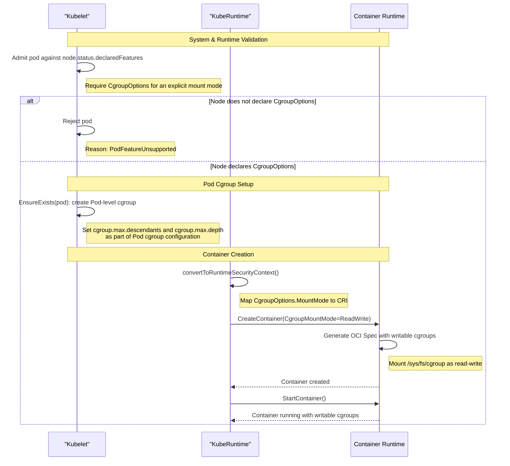

<!-- toc -->
- [Release Signoff Checklist](#release-signoff-checklist)
- [Summary](#summary)
- [Motivation](#motivation)
  - [Goals](#goals)
- [Proposal](#proposal)
  - [User Stories (Optional)](#user-stories-optional)
    - [Story 1: Container-in-Container Development](#story-1-container-in-container-development)
    - [Story 2: Dynamic Resource Management](#story-2-dynamic-resource-management)
  - [Notes/Constraints/Caveats (Optional)](#notesconstraintscaveats-optional)
  - [Risks and Mitigations](#risks-and-mitigations)
  - [cpuset Isolation](#cpuset-isolation)
  - [Verified Behavior](#verified-behavior)
    - [Descendant Cgroup Memory Accounting](#descendant-cgroup-memory-accounting)
    - [Kubelet Stats Collection](#kubelet-stats-collection)
- [Design Details](#design-details)
  - [API Changes](#api-changes)
    - [Core API Types](#core-api-types)
    - [CRI API Changes](#cri-api-changes)
      - [Descendant and Depth Limits (Pod-level, no CRI changes)](#descendant-and-depth-limits-pod-level-no-cri-changes)
  - [Implementation Details](#implementation-details)
    - [CgroupOptions Implementation Flow](#cgroupoptions-implementation-flow)
    - [Validation](#validation)
    - [Pod Security Standards](#pod-security-standards)
  - [Test Plan](#test-plan)
      - [Prerequisite testing updates](#prerequisite-testing-updates)
      - [Unit tests](#unit-tests)
      - [Integration tests](#integration-tests)
      - [e2e tests](#e2e-tests)
  - [Graduation Criteria](#graduation-criteria)
    - [Alpha](#alpha)
    - [Beta](#beta)
    - [GA](#ga)
  - [Upgrade / Downgrade Strategy](#upgrade--downgrade-strategy)
  - [Version Skew Strategy](#version-skew-strategy)
- [Production Readiness Review Questionnaire](#production-readiness-review-questionnaire)
  - [Feature Enablement and Rollback](#feature-enablement-and-rollback)
  - [Rollout, Upgrade and Rollback Planning](#rollout-upgrade-and-rollback-planning)
  - [Monitoring Requirements](#monitoring-requirements)
  - [Dependencies](#dependencies)
  - [Scalability](#scalability)
  - [Troubleshooting](#troubleshooting)
- [Implementation History](#implementation-history)
- [Drawbacks](#drawbacks)
- [Alternatives](#alternatives)
  - [Alternative 1: Runtime-specific Annotations](#alternative-1-runtime-specific-annotations)
  - [Alternative 2: Boolean Field Instead of Struct](#alternative-2-boolean-field-instead-of-struct)
  - [Alternative 3: Runtime Auto-Detection (Implicit Behavior)](#alternative-3-runtime-auto-detection-implicit-behavior)
  - [Alternative 4: Node-Level Configuration (NRI Plugin or CRI Config)](#alternative-4-node-level-configuration-nri-plugin-or-cri-config)
- [Infrastructure Needed (Optional)](#infrastructure-needed-optional)
<!-- /toc -->

## Release Signoff Checklist


Items marked with (R) are required *prior to targeting to a milestone / release*.

- [ ] (R) Enhancement issue in release milestone, which links to KEP dir in [kubernetes/enhancements] (not the initial KEP PR)
- [x] (R) KEP approvers have approved the KEP status as `implementable`
- [x] (R) Design details are appropriately documented
- [x] (R) Test plan is in place, giving consideration to SIG Architecture and SIG Testing input (including test refactors)
  - [ ] e2e Tests for all Beta API Operations (endpoints)
  - [ ] (R) Ensure GA e2e tests meet requirements for [Conformance Tests](https://github.com/kubernetes/community/blob/master/contributors/devel/sig-architecture/conformance-tests.md) 
  - [ ] (R) Minimum Two Week Window for GA e2e tests to prove flake free
- [x] (R) Graduation criteria is in place
  - [ ] (R) [all GA Endpoints](https://github.com/kubernetes/community/pull/1806) must be hit by [Conformance Tests](https://github.com/kubernetes/community/blob/master/contributors/devel/sig-architecture/conformance-tests.md) 
- [ ] (R) Production readiness review completed
- [ ] (R) Production readiness review approved
- [x] "Implementation History" section is up-to-date for milestone
- [ ] User-facing documentation has been created in [kubernetes/website], for publication to [kubernetes.io]
- [ ] Supporting documentation—e.g., additional design documents, links to mailing list discussions/SIG meetings, relevant PRs/issues, release notes


[kubernetes.io]: https://kubernetes.io/
[kubernetes/enhancements]: https://git.k8s.io/enhancements
[kubernetes/kubernetes]: https://git.k8s.io/kubernetes
[kubernetes/website]: https://git.k8s.io/website

## Summary

This KEP proposes adding a `CgroupOptions` struct field to the container SecurityContext in Kubernetes to allow unprivileged containers to have writable access to cgroup interfaces on cgroup v2 systems. This feature relies on the kernel's `nsdelegate` mount option to ensure containers can only manage their own cgroup subtrees, preventing unauthorized access to system resources. The explicit API field is required to provide visibility, policy enforcement, and defense-in-depth for this capability.

## Motivation

 With cgroup v2's secure delegation model, unprivileged containers can safely manage their own cgroup subtree without compromising system security. To support this, a configuration option can be introduced to ensure that, when cgroup v2 is enabled, the cgroup interface (/sys/fs/cgroup) is mounted with read-write permissions for containers.

By exposing the `CgroupOptions` field through the Kubernetes API and CRI interface, container runtimes can be updated to honor the setting via CRI, enabling unprivileged containers to take advantage of writable cgroups in a secure manner.

While the `nsdelegate` mount option makes this safe from a kernel isolation perspective, it represents a significant change in the container's capabilities. Requiring an explicit opt-in via the API ensures this capability is visible to cluster administrators, can be restricted via policy (e.g., Pod Security Standards), and maintains the principle of defense-in-depth by keeping the default secure and restricted.

Related Issues:
- https://github.com/containerd/containerd/issues/10924
- https://github.com/kubernetes/kubernetes/issues/121190

### Goals

- Add a `CgroupOptions` struct field to the container SecurityContext object for extensibility
- CRI API changes
- Integrate with Pod Security Standards to ensure appropriate security policy enforcement
- Container runtime modifications
- Maintain backward compatibility with existing workloads

## Proposal

Add a new `CgroupOptions` struct field to the `SecurityContext` in the core v1 API. This struct-based approach provides extensibility for future cgroup-related configurations. When `mountMode` is set to `ReadWrite` on cgroup v2 systems, it instructs the container runtime to mount the cgroup filesystem with write permissions for the container's own cgroup subtree.

```yaml
apiVersion: v1
kind: Pod
metadata:
  name: writable-cgroups-example
spec:
  containers:
  - name: app
    image: myapp:latest
    securityContext:
      cgroupOptions:
        mountMode: ReadWrite
```

### User Stories (Optional)

#### Story 1: Container-in-Container Development

As a developer, I need to run Docker-in-Docker for testing and development purposes. Currently, I need to use privileged containers which exposes unnecessary security risks. With `CgroupOptions.MountMode: ReadWrite`, I can run these nested containers securely while still allowing them to manage their own resource constraints.

#### Story 2: Dynamic Resource Management

As a developer, I might want to create sub-cgroups for finer granularity and concise control over the different in-pod processes. For instance, distributed AI/ML frameworks like Ray can create sub-cgroups for each worker process and dynamically adjust CPU and memory limits based on workload patterns, enabling better resource utilization and isolation without requiring privileged access.
Another example is, [KubeVirt](https://github.com/kubevirt/kubevirt) runs a hypervisor and a guest VM in the same unprivileged pod which sometimes demands to divide the resources between the management layer (hypervisor + management processes) and the guest layer (e.g. vCPU processes). Currently the management of sub-cgroups is done by a privileged component in a somewhat hacky way, but with writable cgroups the unprivileged pod itself could create and manage these cgroups.


### Notes/Constraints/Caveats (Optional)

- **cgroup v2 Only**: `mountMode: ReadWrite` requires cgroup v2
- **Linux Only**: The field is only valid on Linux containers and will be validated accordingly
- **Runtime Support**: Requires container runtime support
- **Node Configuration**: The host's cgroup v2 filesystem must be mounted with `nsdelegate`, and the kubelet must manage a cgroup per Pod (`--cgroups-per-qos`).
- **Descendant Limits**: When `mountMode: ReadWrite` is enabled, the kubelet applies descendant and depth limits to the Pod cgroup before any container starts; see [Descendant and Depth Limits](#descendant-and-depth-limits-pod-level-no-cri-changes).
- **Security Context Integration**: Must work cohesively with other SecurityContext fields

### Risks and Mitigations

| Risk | Mitigation |
|------|------------|
| **Security Bypass**: Containers gaining unauthorized access to system cgroups | Only allow write access to container's own cgroup subtree. cgroup v2 delegation model provides isolation |
| **Resource Exhaustion**: Containers setting inappropriate resource limits | Kubernetes resource quotas and limit ranges still apply. Container cannot exceed pod-level limits |
| **Pod Security Policy Bypass**: Feature being used in restricted environments | Integration with Pod Security Standards to block in restricted profiles |
| **Runtime Incompatibility**: Feature not working with older runtimes | The scheduler excludes unsupported nodes, and kubelet admission rejects Pods with an explicit cgroup mount mode on those nodes. |
| **cpuset Isolation**: Containers could modify `cpuset.cpus` to access CPUs allocated to other workloads by CPU Manager. | The `nsdelegate` mount option for cgroup v2 prevents containers from modifying their own resource limits (like `cpuset.cpus`). They can only create and manage sub-cgroups within their allocated constraints. |
| **Cgroup Descendant Exhaustion**: A container could create many descendant cgroups, exhausting node-level resources (memory and `inotify` watches were observed in the experiment) that are not counted against the container's `memory.max` limit, causing the node to become `NotReady`. | The kubelet applies per-Pod limits on the number and depth of live descendants; see [Descendant and Depth Limits](#descendant-and-depth-limits-pod-level-no-cri-changes) for scope and failure behavior. |

### cpuset Isolation

**Problem**: If a container has write access to its cgroup directory, it might attempt to modify sensitive resource limits like `cpuset.cpus` to access CPUs allocated to other workloads.

**Mitigation**:

The `nsdelegate` mount option for cgroup v2 provides kernel-level protection. When `/sys/fs/cgroup` is mounted with `nsdelegate` and the container is in its own cgroup namespace, the kernel prevents the container from modifying its own resource limits. It can enable controllers for child cgroups and manage resources within those sub-cgroups.

This feature relies on `nsdelegate` being supported and configured on the host. If the host does not mount cgroup v2 with `nsdelegate`, the kubelet and the runtime MUST fail creation of any container that requests `ReadWrite`.

### Verified Behavior

#### Descendant Cgroup Memory Accounting

A container with `cgroupOptions.mountMode: ReadWrite` and `memory.max: 128Mi` running on a GKE node (COS 125, kernel 6.12.68+, cgroup v2) was able to create approximately 42,000 sibling cgroups before any `mkdir` failed.

During the test:

- Container `memory.current` grew from 97 MB to 122 MB (within its limit).
- Node `Slab` grew from 200 MB to over 800 MB.
- Node `MemAvailable` dropped from 14.3 GB to ~20 MB.
- Before `NotReady`, the node raised a `ResourceExhausted` condition for `inotify-pressure` (100% of one user's watch quota, 12,288 watches).
- The node entered `NotReady`.

The container stayed within its own `memory.max` while the node ran out of memory and exhausted the inotify watch quota of one user, so the container's memory limit alone does not bound node-level resource consumption from descendant cgroups. To bound live descendants, the kubelet applies `cgroup.max.descendants` and `cgroup.max.depth` on the Pod-level cgroup it already manages when writable cgroups is enabled for the Pod.

#### Kubelet Stats Collection

By default, the kubelet's cAdvisor discovers and watches every cgroup under the
Pod cgroups, including cgroups that containers create. On a kind node running
v1.37.0, a container created 200 cgroups inside its own cgroup. The kubelet
gained 200 inotify watches, 200 housekeeping goroutines, and 200 series on
`/metrics/cadvisor`. The kubelet released all of them when the container removed
the cgroups. The Pod descendant limit caps each Pod subtree at 250 cgroups, and
therefore at 250 watches.

When the `PodAndContainerStatsFromCRI` feature gate
([KEP-2371](../2371-cri-pod-container-stats/README.md)) is enabled and the
runtime implements `PodSandboxStats`, the kubelet disables cAdvisor's container
discovery and does not watch cgroups that containers create. The runtime reports
Pod and container stats from the Pod cgroup and each container's cgroup. These
stats include the usage of cgroups that containers create because cgroup v2
accounts usage hierarchically.

## Design Details

### API Changes

#### Core API Types

Add `CgroupOptions` struct field to `SecurityContext` in both internal and external API:

**Files**: `staging/src/k8s.io/api/core/v1/types.go`, `pkg/apis/core/types.go`
```go
type SecurityContext struct {
    // ... existing fields ...

    // cgroupOptions holds the cgroup options for this container.
    // If mountMode is specified, the scheduler only places the pod on a node
    // whose status.declaredFeatures includes CgroupOptions.
    // (Alpha) This field requires the CgroupOptions feature gate to be enabled.
    // This field cannot be set for ephemeral containers or when spec.os.name is windows.
    // +featureGate=CgroupOptions
    // +optional
    // +k8s:optional
    CgroupOptions *CgroupOptions `json:"cgroupOptions,omitempty" protobuf:"bytes,13,opt,name=cgroupOptions"`
}

// CgroupOptions defines options for cgroup filesystem access.
type CgroupOptions struct {
    // mountMode controls how the cgroup filesystem is mounted in the container.
    // Valid values are "ReadOnly" and "ReadWrite". If not specified, the
    // container runtime's default mount mode is used.
    // The kubelet refuses to create a container with an unrecognized value.
    // "ReadOnly" cannot be set when the container's privileged field is true.
    // "ReadWrite" cannot be set when spec.hostNetwork is true and
    // spec.hostUsers is false.
    // +optional
    // +k8s:optional
    MountMode *CgroupMountMode `json:"mountMode,omitempty" protobuf:"bytes,1,opt,name=mountMode"`
}

// CgroupMountMode defines how the cgroup filesystem is mounted in a container.
// +enum
// +k8s:enum
type CgroupMountMode string

const (
    // CgroupMountModeReadOnly mounts the cgroup filesystem read-only.
    CgroupMountModeReadOnly CgroupMountMode = "ReadOnly"
    // CgroupMountModeReadWrite mounts the cgroup filesystem read-write.
    CgroupMountModeReadWrite CgroupMountMode = "ReadWrite"
)
```

**Verify Node Support:**

The kubelet declares `CgroupOptions` in `node.status.declaredFeatures` when the
feature gate is enabled and the CRI implementation advertises
`cgroup_mount_mode` in `RuntimeFeatures`.

Both explicit mount modes require the declared feature. An omitted `mountMode`,
including an empty `cgroupOptions` object, uses the runtime default and does not
require `CgroupOptions`. Descendant and depth limits apply only when a container
requests `ReadWrite`.

The scheduler excludes nodes that do not declare the feature for Pods requesting
`mountMode: ReadOnly` or `mountMode: ReadWrite`. Kubelet admission rejects such
Pods with `PodFeatureUnsupported` if they reach an unsupported node directly. See
[KEP-5328](../5328-node-declared-features/README.md).

When the kubelet creates a container that requests `ReadWrite`, it checks that
the host has cgroup v2, `nsdelegate`, and a Pod cgroup. If the host lacks any of
them, the container fails with `CreateContainerConfigError`.

#### CRI API Changes

**File**: `staging/src/k8s.io/cri-api/pkg/apis/runtime/v1/api.proto`
```protobuf
message LinuxContainerSecurityContext {
    // ... existing fields ...

    // cgroup_mount_mode controls how the cgroup filesystem is mounted in the
    // container.
    CgroupMountMode cgroup_mount_mode = 18;
}

// CgroupMountMode defines how the cgroup filesystem is mounted in a container.
// The runtime MUST fail container creation if it cannot honor the requested
// mode.
enum CgroupMountMode {
    // CGROUP_MOUNT_MODE_UNSPECIFIED uses the runtime's default mount mode.
    CGROUP_MOUNT_MODE_UNSPECIFIED = 0;
    // CGROUP_MOUNT_MODE_READ_ONLY mounts the cgroup filesystem read-only.
    // A privileged container's cgroup filesystem is always writable. The
    // runtime fails creation of a privileged container that requests this
    // mode.
    CGROUP_MOUNT_MODE_READ_ONLY = 1;
    // CGROUP_MOUNT_MODE_READ_WRITE mounts the cgroup filesystem read-write.
    // This mode requires the host to mount cgroup v2 with nsdelegate.
    // The runtime MUST fail container creation for CGROUP_MOUNT_MODE_READ_WRITE
    // with CgroupNamespace.Mode=NODE when the container is not privileged.
    CGROUP_MOUNT_MODE_READ_WRITE = 2;
}

message RuntimeFeatures {
    // ... existing fields (e.g. supplemental_groups_policy) ...

    // cgroup_mount_mode is set to true if the runtime supports the
    // cgroup_mount_mode field of LinuxContainerSecurityContext.
    bool cgroup_mount_mode = 4;
}
```

When `mountMode` is omitted, the kubelet leaves `cgroup_mount_mode` at
`CGROUP_MOUNT_MODE_UNSPECIFIED`, its zero value. The runtime uses its default
mount mode. For example, containerd's `cgroup_writable` configuration field
([internal/cri/config/config.go:108-109](https://github.com/containerd/containerd/blob/v2.3.5/internal/cri/config/config.go#L108-L109))
can make this default writable. An explicit `ReadOnly` maps to
`CGROUP_MOUNT_MODE_READ_ONLY` and overrides the runtime's default.

A runtime must fail container creation if it cannot honor the requested mode,
including:

- `CGROUP_MOUNT_MODE_READ_ONLY` on a privileged container.
- `CGROUP_MOUNT_MODE_READ_WRITE` when the host does not mount cgroup v2 with
  `nsdelegate`.
- `CGROUP_MOUNT_MODE_READ_WRITE` with `CgroupNamespace.Mode=NODE`
  ([KEP-5714](../5714-cgroupns/README.md)) on an unprivileged container.

Each `CgroupOptions` option has its own `RuntimeFeatures` capability.

##### Descendant and Depth Limits (Pod-level, no CRI changes)

When a Pod opts into writable cgroups, the kubelet applies `cgroup.max.descendants`
of 250 and `cgroup.max.depth` of 50 to the Pod cgroup it manages. These limits cover
live descendants throughout the Pod subtree, including container cgroups. No CRI
changes are required.

The limits apply separately to each Pod. After a cgroup directory is removed, its
kernel resources can remain allocated until cleanup completes.

For alpha, the kubelet sets the limits once when creating the Pod cgroup and
does not reconcile incomplete Pod cgroup configuration
([kubernetes/kubernetes#144075](https://github.com/kubernetes/kubernetes/issues/144075)).
If applying the configuration fails, the kubelet logs `cgroup manager.Set failed`
and starts the Pod's containers. A kubelet restart between creating the Pod
cgroup and applying its configuration also leaves the cgroup unconfigured. For
beta, the kubelet will reconcile Pod cgroup configuration before starting
containers when applying it fails or is interrupted by a restart.

### Implementation Details

#### CgroupOptions Implementation Flow



#### Validation

**Node Support Validation**

The scheduler and the kubelet's pod admission handler enforce the declared
feature described under [API Changes](#api-changes). The kubelet enforces the
host prerequisites of `ReadWrite` when creating the container.

**System Validation**:

`cgroupOptions.mountMode` accepts `ReadOnly` and `ReadWrite`:

- `ReadOnly` is rejected when `privileged` is true because a privileged container's cgroup filesystem is writable outside a host-network user namespace. `ReadWrite` is allowed when `privileged` is true and keeps the same node, host, and Pod limit requirements.
- `ReadWrite` is rejected when `spec.hostNetwork` is true and `spec.hostUsers` is false ([KEP-5607](../5607-hostnetwork-userns/README.md)) because the runtime bind-mounts the host's `/sys` read-only in that configuration.
- `cgroupOptions` cannot be set when `spec.os.name` is `windows`, following the other Linux-only `securityContext` fields.
- `cgroupOptions` cannot be set on ephemeral containers or [dynamic containers](../5972-dynamic-containers/README.md) because the node's declared feature and the Pod cgroup limits are evaluated only at Pod creation.

**File**: `pkg/kubelet/kuberuntime/security_context.go`

The container-create check described under [API Changes](#api-changes) runs
during CRI security context conversion.

**Pod-Level Descendant and Depth Limits**

The kubelet includes the descendant and depth limits in the cgroup v2 `Unified`
parameters when creating the Pod cgroup. See
[Descendant and Depth Limits](#descendant-and-depth-limits-pod-level-no-cri-changes)
for the values and failure behavior.

#### Pod Security Standards

The Restricted profile requires `cgroupOptions.mountMode` to be unset or
`ReadOnly`. The Baseline and Privileged profiles do not restrict the field.

### Test Plan

[x] I/we understand the owners of the involved components may require updates to
existing tests to make this code solid enough prior to committing the changes necessary
to implement this enhancement.

##### Prerequisite testing updates

- Update existing SecurityContext validation tests to include CgroupOptions field
- Ensure backward compatibility with existing SecurityContext tests

##### Unit tests

Coverage for new and existing packages:

- `k8s.io/kubernetes/pkg/apis/core/validation`:  Unit tests for CgroupOptions validation logic, Linux-only constraints, and ephemeral-container exclusion
- `k8s.io/kubernetes/pkg/kubelet/kuberuntime`: Security context conversion tests including CgroupOptions mapping
- `k8s.io/kubernetes/pkg/kubelet/cm`: Pod cgroup limit configuration
- `k8s.io/pod-security-admission/policy`: Pod Security Standards policy enforcement tests
- `k8s.io/component-helpers/nodedeclaredfeatures/features/cgroupoptions`: Node feature discovery and Pod requirement inference

##### Integration tests

- API server validation, including Linux-only enforcement and ephemeral-container exclusion
- Feature gate handling: field removal on create and preservation on existing Pods
- Pod Security Standards admission controller integration
- Scheduling excludes nodes that do not declare `CgroupOptions` for Pods with an explicit cgroup mount mode

##### e2e tests

- `test/e2e_node/cgroup_options_test.go`: Node E2E tests covering:
  - Basic functionality (writable vs read-only cgroups)
  - Multi-container pods with mixed settings
  - Integration with other SecurityContext fields
  - Node support requirements during kubelet admission
  - Containers not able to "escape" the resource limits set by the Pod
  - Runtime compatibility checks
  - Pod descendant and depth limits
- `critest`: a CRI conformance test in [cri-tools](https://github.com/kubernetes-sigs/cri-tools) exercising `cgroup_mount_mode` and its `RuntimeFeatures` advertisement, so container runtimes implementing the CRI API can validate conformance independently of Kubernetes.

### Graduation Criteria

#### Alpha

- **Alpha-1**
  - Feature implemented behind a feature gate `CgroupOptions`
  - Basic API, validation, and kubelet implementation completed

- **Alpha-2**
  - CRI API and container runtime changes
  - At least one runtime (containerd or CRI-O) implementing the CRI API merged to its dev branch or marked experimental, with an e2e test alongside, per the [CRI API dev policy](https://www.kubernetes.dev/docs/code/cri-api-dev-policies/#same-maturity-level-for-alpha)
  - Unit and integration tests implemented
  - Pod Security Standards integration complete
  - Node E2E tests passing on v2 systems

#### Beta

- Feature gate enabled by default
- E2E tests stable and passing consistently
- Both containerd and CRI-O support the feature in a released version, per the [CRI API dev policy](https://www.kubernetes.dev/docs/code/cri-api-dev-policies/#same-maturity-level-for-beta-and-ga)
- Re-evaluate the Pod descendant and depth limit defaults of 250 and 50 with alpha feedback
- Reconcile Pod cgroup configuration, including the descendant and depth limits, when applying it fails or is interrupted by a kubelet restart ([kubernetes/kubernetes#144075](https://github.com/kubernetes/kubernetes/issues/144075))
- Decide whether dynamic containers can set `cgroupOptions`
- When `hostCgroupNamespace` ([KEP-5714](../5714-cgroupns/README.md)) lands, reject `ReadWrite` in the Pod API for unprivileged containers because `nsdelegate` requires a private cgroup namespace to confine writes ([kubernetes/kubernetes#143673](https://github.com/kubernetes/kubernetes/pull/143673))
- Evaluate exposing the limits in `KubeletConfiguration` for per-node tuning
- Document that the kubelet watches cgroups that containers create unless `PodAndContainerStatsFromCRI` is enabled and the runtime implements `PodSandboxStats`. Recommend enabling the gate on nodes that run Pods with writable cgroups

#### GA

- Feature stable and ready for production use
- `PodAndContainerStatsFromCRI` is enabled by default; see [Kubelet Stats Collection](#kubelet-stats-collection)
- Conformance tests implemented where applicable
- Documentation completed

### Upgrade / Downgrade Strategy

Enable/disable the feature gate

**Upgrade**: 
- New field is optional and defaults to `nil` (no change in behavior)
- Existing workloads continue to function without modification

**Update Flow**:
- `CgroupOptions` field is **immutable** after pod creation. Neither ephemeral containers nor dynamic containers can set it.
- Changes to `CgroupOptions` require pod recreation (delete + create)

**Downgrade**:

*Two scenarios depending on downgrade type:*

**Feature Gate Disabled (same Kubernetes version):**

- Disabling the gate on kube-apiserver drops `cgroupOptions` from new Pods and preserves it on existing Pods.
- Restarting kubelet with the gate disabled rejects existing Pods with an explicit cgroup mount mode at admission with `PodFeatureUnsupported`. The Pods enter `Failed`, and kubelet terminates their running containers, per the [Node Declared Features policy](../5328-node-declared-features/README.md#declared-feature-changes-on-existing-nodes).
- Replacement Pods use the runtime's default cgroup mount mode if the apiserver gate is disabled. With that gate enabled, they require a node that declares `CgroupOptions`.

**True Version Downgrade (to Kubernetes version without CgroupOptions field):**
- The older apiserver does not recognize the field and drops it when it reads stored Pods. Older kubelets never see it. Running containers keep their current cgroup mount until they restart, after which they use the runtime's default.
- New requests that set the field are rejected only when the client asks for strict field validation, which `kubectl` does by default. For other clients the apiserver drops the field and returns a warning.
- Remove the field from pod specs before downgrading

### Version Skew Strategy

The scheduler must recognize `CgroupOptions` before the feature is enabled.
Otherwise, it can place Pods on older kubelets that ignore the field.

**kubelet vs Container Runtime**:
A node whose runtime does not advertise `cgroup_mount_mode` does not declare
`CgroupOptions`. The scheduler excludes it for Pods with an explicit cgroup mount mode.

**apiserver vs kubelet**:
The scheduler excludes nodes whose kubelet predates the feature or has its gate
disabled. API field handling is described under
[Upgrade / Downgrade Strategy](#upgrade--downgrade-strategy).

## Production Readiness Review Questionnaire


### Feature Enablement and Rollback


###### How can this feature be enabled / disabled in a live cluster?

- [x] Feature gate (also fill in values in `kep.yaml`)
  - Feature gate name: `CgroupOptions`
  - Components depending on the feature gate: kubelet, kube-apiserver
- [ ] Other

The feature can be controlled via:
1. **Feature Gate**: `--feature-gates=CgroupOptions=true/false`
2. **Runtime Support**: Requires compatible container runtime
3. **Pod Specification**: Per-container `securityContext.cgroupOptions.mountMode` field

- Will enabling / disabling the feature require downtime of the control plane? **Yes**
- Will enabling / disabling the feature require downtime or reprovisioning of a node? **Yes** (kubelet restart required for feature gate changes)

###### Does enabling the feature change any default behavior?

**No**. Containers that omit `securityContext.cgroupOptions.mountMode` continue to use the runtime's default mount mode. Explicit `ReadOnly` and `ReadWrite` requests select the corresponding mount mode.

###### Can the feature be disabled once it has been enabled (i.e. can we roll back the enablement)?

**Yes**. Restarting kubelet with the gate disabled terminates Pods with an explicit
cgroup mount mode. Disabling it on kube-apiserver drops the field from new Pods.
See [Upgrade / Downgrade Strategy](#upgrade--downgrade-strategy).

###### What happens if we reenable the feature if it was previously rolled back?

New Pods with an explicit `ReadOnly` or `ReadWrite` mount mode can be created again. Pods marked `Failed` during rollback must be replaced.

###### Are there any tests for feature enablement/disablement?

Tests will verify:

- Feature gate disabled: the apiserver drops `cgroupOptions` from new Pods and preserves it on existing Pods
- Feature gate enabled: API accepts and kubelet processes the field correctly
- Runtime compatibility testing with and without feature support


### Rollout, Upgrade and Rollback Planning

This section complements [Feature Enablement and Rollback](#feature-enablement-and-rollback) above with rollout-specific failure modes.

###### How can a rollout or rollback fail? Can it impact already running workloads?

Possible rollout failure modes:

- **Version skew (apiserver enabled, kubelet not)**: With a scheduler that recognizes the feature, Pods with an explicit cgroup mount mode remain `Pending` if no compatible node is available.
- **Runtime missing CRI support**: The node does not declare `CgroupOptions`. The scheduler excludes it for Pods with an explicit cgroup mount mode.
- **Host missing cgroup v2, `nsdelegate`, or per-Pod cgroups**: Because the node still declares `CgroupOptions` when its runtime supports the field, the scheduler can place a `ReadWrite` Pod on it. The kubelet rejects the container at creation, leaving it `Waiting` with reason `CreateContainerConfigError`.

Rollback (disabling the feature gate):

- Disabling the gate on kube-apiserver drops `cgroupOptions` from new Pods, which then use the runtime's default cgroup mount mode. Operations that require writable cgroups fail if that default is read-only.
- Restarting kubelet with the gate disabled terminates Pods with an explicit cgroup mount mode; see [Upgrade / Downgrade Strategy](#upgrade--downgrade-strategy).

No impact on workloads that do not opt in to the feature.

###### What specific metrics should inform a rollback?

No dedicated metrics for alpha. Existing kubelet pod-startup counters (`kubelet_started_pods_errors_total`, `kubelet_runtime_operations_errors_total`) do not carry a feature-level label that can isolate this feature's impact, so operators should:

- Audit which pods opt in (see the kubectl query under [Monitoring Requirements](#monitoring-requirements)).
- Watch scheduler events for opted-in Pods stuck `Pending`, and `PodFeatureUnsupported` events for kubelet admission failures.
- Track restart rates for opted-in pods.

Whether to add a feature-specific dimension to existing counters is deferred to beta, contingent on observed adoption.

###### Were upgrade and rollback tested? Was the upgrade->downgrade->upgrade path tested?

TODO: requires the alpha implementation in kubernetes/kubernetes and a container runtime supporting the new CRI field. Plan: implement in kubernetes and containerd, then exercise the upgrade -> downgrade -> upgrade flow in `kind` (cheap to swap node images and flip feature gates). Cases to cover:

- Enable feature gate, create pod with `cgroupOptions.mountMode: ReadWrite`, confirm container has writable `/sys/fs/cgroup`.
- Disable the gate on kube-apiserver, confirm it drops the field from new Pods and preserves it on existing Pods.
- Disable the gate on kubelet and restart it. Confirm existing Pods with an explicit cgroup mount mode enter `Failed` and their containers are terminated.
- Re-enable feature gate, confirm new pods can be created again.

True version downgrade behavior (to a kubernetes version without the field) is described under [Upgrade / Downgrade Strategy](#upgrade--downgrade-strategy).

###### Is the rollout accompanied by any deprecations and/or removals of features, APIs, fields of API types, flags, etc.?

No.


### Monitoring Requirements

###### How can an operator determine if the feature is in use by workloads?

By inspecting Pod specs:

```
kubectl get pods -A -o json \
  | jq '.items[] | select([.spec.containers[]?, .spec.initContainers[]?] | any(.securityContext.cgroupOptions.mountMode != null)) | {namespace: .metadata.namespace, name: .metadata.name}'
```

This follows the alpha pattern used by KEP-3857 (recursive read-only mounts) and KEP-4639 (OCI volume source). A dedicated metric can be considered at beta if there is demand.

###### How can someone using this feature know that it is working for their instance?

From inside the container:

- `mount | grep '^cgroup2'` should show `/sys/fs/cgroup` mounted with `rw`.
- `mkdir /sys/fs/cgroup/test && rmdir /sys/fs/cgroup/test` should succeed.

Check `node.status.declaredFeatures` for `CgroupOptions`. The scheduler excludes nodes that do not declare it for Pods with an explicit cgroup mount mode. Kubelet admission rejects such Pods if they reach an unsupported node directly. The kubelet also checks the host prerequisites when it creates a container requesting `ReadWrite`. A failed check leaves the container `Waiting` with reason `CreateContainerConfigError`. The message names the missing prerequisite. [What are other known failure modes?](#what-are-other-known-failure-modes) lists each message.

- [x] Events
  - Event Reason: `PodFeatureUnsupported` when kubelet admission rejects a Pod with an explicit cgroup mount mode on an unsupported node.
- [ ] API .status
- [ ] Other (treat as last resort)

###### What are the reasonable SLOs (Service Level Objectives) for the enhancement?

No dedicated SLOs at alpha. Existing pod startup SLOs apply.

Beta will revisit whether a startup-latency SLO scoped to opted-in pods is warranted.

###### What are the SLIs (Service Level Indicators) an operator can use to determine the health of the service?

For alpha, existing kubelet SLIs apply:

- `kubelet_pod_start_duration_seconds`
- `kubelet_started_pods_errors_total`

- [ ] Metrics
- [x] Other (treat as last resort)
  - Details: For alpha, rely on existing kubelet metrics combined with pod-spec audit (above), scheduler events, and `PodFeatureUnsupported` events for per-pod failure attribution.

###### Are there any missing metrics that would be useful to have to improve observability of this feature?

None planned for alpha. The dominant pattern for SecurityContext-adjacent alpha features (KEP-3857, KEP-4639, KEP-2400) is to defer dedicated metrics until beta. If beta uptake reveals a need for fleet-wide visibility, candidates to consider are: a per-feature label on existing pod-startup counters, or a dedicated `kubelet_writable_cgroup_pods` gauge (matching the KEP-127 pattern, which added `started_user_namespaced_pods_total` at beta).


### Dependencies

###### Does this feature depend on any specific services running in the cluster?

No new in-cluster services. The feature depends on:

- A Linux kernel with cgroup v2 support.
- The host's `/sys/fs/cgroup` mounted with the `nsdelegate` option (the default in modern systemd; required for safe operation, see [cpuset Isolation](#cpuset-isolation)).
- A container runtime that supports the new CRI `cgroup_mount_mode` field and advertises it in the node-level `RuntimeFeatures`.
- A kubelet managing a cgroup per Pod (`--cgroups-per-qos`).
- Node Declared Features enabled in kube-scheduler and kubelet.

### Scalability

###### Will enabling / using this feature result in any new API calls?

No.

###### Will enabling / using this feature result in introducing new API types?

No new top-level types. The feature adds a nested `CgroupOptions` struct and a `CgroupMountMode` string enum inside the existing `SecurityContext`.

###### Will enabling / using this feature result in any new calls to the cloud provider?

No.

###### Will enabling / using this feature result in increasing size or count of the existing API objects?

Marginal. Pods opting in to the feature add a small nested object containing a single string enum to their spec. Pods that do not opt in are unchanged.

###### Will enabling / using this feature result in increasing time taken by any operations covered by existing SLIs/SLOs?

No measurable impact. The scheduler filters nodes using Node Declared Features, and kubelet admission checks the Pod requirements against the node's declared features. Host and runtime support are discovered at kubelet startup.

###### Will enabling / using this feature result in non-negligible increase of resource usage (CPU, RAM, disk, IO, ...) in any components?

The feature does not add controllers. By default, the kubelet's cAdvisor adds an inotify watch and a housekeeping goroutine for each cgroup that a container creates, up to the Pod descendant limit. With `PodAndContainerStatsFromCRI` enabled and a runtime that implements `PodSandboxStats`, the kubelet does not watch these cgroups. See [Kubelet Stats Collection](#kubelet-stats-collection).

###### Can enabling / using this feature result in resource exhaustion of some node resources (PIDs, sockets, inodes, etc.)?

Yes. Descendant cgroups consume kernel memory and inotify watches that `memory.max` does not count (see [Verified Behavior](#verified-behavior)). The Pod limits bound live descendants; see [Descendant and Depth Limits](#descendant-and-depth-limits-pod-level-no-cri-changes) for scope and failure behavior.

Mitigations:

- The kubelet applies `cgroup.max.descendants` and `cgroup.max.depth` on the Pod-level cgroup when `mountMode: ReadWrite` is enabled for the Pod.
- With `PodAndContainerStatsFromCRI` enabled and a runtime that implements `PodSandboxStats`, the kubelet does not watch cgroups that containers create; see [Kubelet Stats Collection](#kubelet-stats-collection).
- The feature is opt-in via `cgroupOptions.mountMode: ReadWrite`, so cluster administrators can restrict usage via Pod Security Standards or admission policies.


### Troubleshooting

###### How does this feature react if the API server and/or etcd is unavailable?

No different from existing pod creation. If the apiserver is unavailable, no new pods (including those opting in to writable cgroups) can be created. Pods already running with writable cgroups are unaffected; the feature has no runtime dependency on the control plane after pod startup.

###### What are other known failure modes?

| Failure | Detection | Mitigations | Diagnostics | Testing |
|---|---|---|---|---|
| Container runtime does not support the CRI field | The node does not declare `CgroupOptions`. The scheduler leaves opted-in Pods `Pending` with a `FailedScheduling` event. If an opted-in Pod bypasses the scheduler, kubelet admission rejects it: the Pod enters `Failed` with reason `PodFeatureUnsupported` and message `Pod requires node features that are not available: CgroupOptions` | Use a runtime advertising `cgroup_mount_mode`; or remove the field from the pod spec | `node.status.declaredFeatures`; scheduler and Pod events | unit + integration tests |
| Host is on cgroup v1 | When the kubelet creates a container requesting `ReadWrite`, the container stays `Waiting` with reason `CreateContainerConfigError` and message `writable cgroups require cgroup v2` | Migrate the node to cgroup v2; or remove the field from the pod spec | Pod events; `stat -fc %T /sys/fs/cgroup` reports `cgroup2fs` on cgroup v2 | node support tests |
| Host's `/sys/fs/cgroup` is not mounted with `nsdelegate` | When the kubelet creates a container requesting `ReadWrite`, the container stays `Waiting` with reason `CreateContainerConfigError` and message `writable cgroups require the cgroup filesystem to be mounted with nsdelegate`. The kubelet reads the mount options once, at startup. If `nsdelegate` is removed later, the runtime fails container creation | Mount `/sys/fs/cgroup` with `nsdelegate` and restart kubelet after changing the mount options | Pod events; `findmnt /sys/fs/cgroup`; runtime logs | runtime contract; node support tests |
| Kubelet does not manage a cgroup per Pod (`--cgroups-per-qos=false`) | When the kubelet creates a container requesting `ReadWrite`, the container stays `Waiting` with reason `CreateContainerConfigError` and message `writable cgroups require the kubelet to manage a cgroup per pod (--cgroups-per-qos)` | Enable `cgroupsPerQOS` in the kubelet configuration; or remove the field from the pod spec | Pod events; kubelet `/configz` | node support tests |
| Kubelet cannot apply the Pod descendant and depth limits | For alpha, the kubelet logs `cgroup manager.Set failed` and starts the Pod's containers, or leaves the Pod cgroup unconfigured if restarted before applying its configuration ([kubernetes/kubernetes#144075](https://github.com/kubernetes/kubernetes/issues/144075)) | Fix any cgroup write error reported in the kubelet log, then recreate the Pod | kubelet logs; `cgroup.max.descendants` and `cgroup.max.depth` in the Pod cgroup | none in alpha |
| Pod reaches its descendant limit | `mkdir` returns `EAGAIN` when `cgroup.max.descendants` is reached | Remove unused cgroups inside the container; the limit is per Pod and bounds node resource use | container logs; Pod cgroup `cgroup.stat` | e2e for descendant bound |

###### What steps should be taken if SLOs are not being met to determine the problem?

No SLOs at alpha. If pod startup latency degrades after enabling the feature gate:

1. Check scheduler events for Pods stuck `Pending` and kubelet events for `PodFeatureUnsupported`.
2. Confirm the node lists `CgroupOptions` under `status.declaredFeatures` via `kubectl get node -o yaml`.
3. Confirm the host has cgroup v2 with `nsdelegate` (`findmnt /sys/fs/cgroup`).
4. Follow [Upgrade / Downgrade Strategy](#upgrade--downgrade-strategy) when disabling the gate; restarting kubelet terminates Pods with an explicit cgroup mount mode.

## Implementation History

- **2025-08-25**: KEP written and proposed
- **2026-02-05**: KEP refined to focus strictly on `nsdelegate` for isolation and justify API opt-in requirements
- **2026-06-08**: Per SIG-Node discussion, descendant/depth exhaustion is mitigated by the kubelet setting `cgroup.max.descendants`/`cgroup.max.depth` defaults on the Pod-level cgroup rather than via new CRI fields
- **2026-10-22**: CRI API merged for v1.38 ([kubernetes/kubernetes#139824](https://github.com/kubernetes/kubernetes/pull/139824))
- **2026-11-13**: Alpha implementation merged for v1.38 ([kubernetes/kubernetes#137568](https://github.com/kubernetes/kubernetes/pull/137568))
- **TBD**: Beta implementation targeting v1.39
- **TBD**: GA implementation, target release TBD

## Drawbacks

1. **Runtime Dependency**: Feature requires specific container runtime versions.
1. **Security Complexity**: Adds another security dimension that may need to be considered in Pod Security Standards

## Alternatives

### Alternative 1: Runtime-specific Annotations
Similar to CRI-O's `io.kubernetes.cri-o.cgroup2-mount-hierarchy-rw` annotation approach.

**Pros**: No API changes required
**Cons**: Runtime-specific, not portable, harder to enforce security policies

### Alternative 2: Boolean Field Instead of Struct

Use a simple `WritableCgroups *bool` field instead of the `CgroupOptions` struct:

```go
type SecurityContext struct {
    // WritableCgroups controls whether the container has write access to cgroup interfaces.
    // +optional
    WritableCgroups *bool
}
```

```yaml
securityContext:
  writableCgroups: true
```

**Pros**: 
- Simpler API

**Cons**: 
- Not extensible for future cgroup-related configurations

The struct-based approach (`CgroupOptions`) was chosen to allow future extensibility.

### Alternative 3: Runtime Auto-Detection (Implicit Behavior)

Instead of a new API field, container runtimes could automatically detect if the host has `nsdelegate` enabled and, if so, mount cgroups as read-write.

**Pros**:
- No API changes required.
- "It just works" for configured nodes.

**Cons**:
- **Lack of Visibility**: Cluster administrators cannot easily identify which workloads are using this capability.
- **Policy Enforcement**: Admission controllers and security policies cannot restrict usage since it's not in the Pod spec.
- **Defense in Depth**: It removes a layer of defense. Even if `nsdelegate` is safe, keeping the default restricted protects against potential kernel bugs or implementation flaws.

### Alternative 4: Node-Level Configuration (NRI Plugin or CRI Config)

Instead of a Kubernetes API change, administrators could enable writable cgroups opaquely at the node level. This could be done globally via a CRI configuration (e.g., containerd's `cgroup_writable = true`) or selectively via an NRI plugin (e.g., the experimental [writable-cgroups plugin](https://github.com/containerd/nri/pull/269)) that modifies the OCI spec during container creation.

**Pros**:
- No Kubernetes API changes required.
- Functionality is either available today (CRI config) or deployable out-of-band (NRI plugin).

**Cons**:
- **Pod Security Standards (PSS) Bypass**: Expanding access to a core control knob like cgroups is a security change. It must be visible to and enforceable by native PSS so it can be blocked in the Restricted profile. Node-level configurations apply opaquely, bypassing native PSS enforcement.
- **Violation of Least Privilege**: Cgroups and namespaces are control tools, not sandbox tools. 99% of workloads do not need writable access. Changing the default via CRI config silently over-privileges workloads, risking subtle and hard-to-troubleshoot behavior changes depending on the node a pod lands on.
- **Obscured Workload Intent**: Even if an NRI plugin selectively enables access based on custom annotations or labels, the requirement isn't captured as a first-class field in the Pod Spec. A native API field provides clear defense-in-depth, making the workload's privileges explicit, auditable, and governed directly by the control plane.

## Infrastructure Needed (Optional)

- **Runtime Support**: Coordination with container runtime projects to adopt CRI API changes
- **Documentation**: Updates to Kubernetes documentation and security guides
